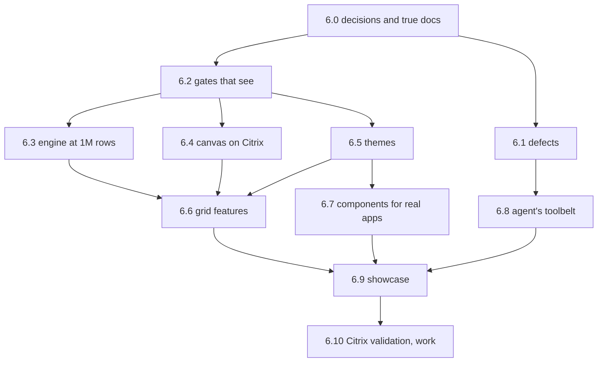

# Plan: demo readiness

This plan takes basis-ui from "the checks are green" to a demo that wins over both the people who build the firm's UIs
and the people who use them. It comes from a review of the whole repo on 2026-11-09, which read `@basis/ui`, its
preset, the theme, parallax's React layer and parallax's Rust engine, and ran the suites, the built gallery and demo,
and a scale experiment. It is written for an agent that has not seen that review. Everything the agent needs is here
or in the files this page names.

The plan adds a Phase 6 to [the roadmap](docs/roadmap.md). Its steps follow the roadmap's rules: one step per branch
and git worktree, named after the step's id, and a pull request whose checks are green.

## Status on 2026-11-10, and how to carry on

**Read this section first.** Steps 6.0 to 6.3.5, 6.4.1 to 6.4.4, 6.5.1 to 6.5.6, 6.7.1 to 6.7.3 and 6.8.1 to 6.8.9 are
built and on `main`, each marked "Built on …" in [the roadmap](docs/roadmap.md#phase-6-demo-readiness) with its
figures. CI was green on every push from `ccb961b` to `1825ac4`. What a step found and left open is in [Found while
building](#found-while-building) at the end of this page.

### Done

| Step  | Commit(s)            | In short                                                                                         |
| ----- | -------------------- | ------------------------------------------------------------------------------------------------ |
| 6.0   | `80c5aa5`            | The decisions in the design, Phase 6 in the roadmap, untrue claims marked "not yet".             |
| 6.1a  | `f057f33`            | 13 component defects.                                                                            |
| 6.1b  | `c316761`            | 14 preset task defects.                                                                          |
| 6.1c  | `d296ebc`, `7de3884` | 11 defects in parallax's TypeScript.                                                             |
| 6.1d  | `ec348f6`            | The engine's three defects.                                                                      |
| 6.2a  | `e656e9a`            | The gallery's 336 section screenshots and axe, `vp run @basis/gallery#shots`.                    |
| 6.2b  | `05cd559`            | The scale harness and its budgets, and the engine's phase profile; `docs/spikes/scale-1m.md`.    |
| 6.2c  | `4588ea0`            | `@basis/ui` shakes, `vp run budget`, motion for a CPU-drawn desktop, the `motion` preference.    |
| 6.3.1 | `0b175cf`            | A load that copies once.                                                                         |
| 6.3.2 | `fd7ddee`, `7de3884` | A progressive load and `useDataset`'s `progress`.                                                |
| 6.3.3 | `e07fa21`            | Sorts on integer keys, orders kept.                                                              |
| 6.3.4 | `bcb09d4`            | Filters as bitmap kernels.                                                                       |
| 6.3.5 | `1825ac4`            | Packed leaf keys and flat tallies. Partly done: see below.                                       |
| 6.4.1 | `3520cd1`, `f2658d4` | Tabular digits on the canvas, at the DOM's sizes.                                                |
| 6.4.2 | `ddaa01f`            | Whole device pixels, baselines at 1.25 and 1.5.                                                  |
| 6.4.3 | `0a20957`            | One draw per frame, three rows a notch.                                                          |
| 6.4.4 | `c328d0b`, `a83ab6e` | A scroll copies the pixels that stay.                                                            |
| 6.5.1 | `e257d8c`            | Tokens for what opacity faked; a solid focus outline.                                            |
| 6.5.2 | `755ec40`, `c46544b` | Control sizes in whole pixels per density; compact is the stylesheet's base.                     |
| 6.5.3 | `9b692b1`            | `defineTheme` and `ThemeInputs`; `vp run @basis/ui#theme [new NAME]`.                            |
| 6.5.4 | `ee2eeb5`            | `checkTheme` in `vp check`; the default theme fixed to pass.                                     |
| 6.5.5 | `dd19320`            | The theme in the cookie and head script, `preferencesDomain`, following another app's change.    |
| 6.5.6 | `731086d`            | Parallax on `@basis/ui`'s theme, 13 dead tokens gone, rows by control size, `basis:themechange`. |
| 6.7.1 | `1af39dc`            | `Page`, shell slots and groups, scoped shortcuts, the demo in the shell, the shell's axe fixed.  |
| 6.7.2 | `e5edd47`            | `FilterBar`, its state in typed search parameters.                                               |
| 6.7.3 | `6f432c8`            | `DataTable` controllable and fast at its cap; pages 50 rows by default.                          |
| 6.8.1 | `7e434e2`            | `vp run docs NAME` and `--search`; the catalogue complete; README split; `CHANGELOG.md`.         |
| 6.8.2 | `bc608c0`            | Six lint limits loosened in app code; messages that name the fix.                                |
| 6.8.3 | `3d356fe`            | The open doors closed, each an `ERROR` line.                                                     |
| 6.8.4 | `5659229`, `b9e1088` | `vp run verify`, `--json`; the fast commit hook and the push hook.                               |
| 6.8.5 | `9c22362`            | `shot`'s network and axe reports, `--all`, `--compare`, `--selector`, `--step`.                  |
| 6.8.6 | `5a4fb5f`            | `vp run new table\|page\|form`, `vp run fixtures new\|check`.                                    |
| 6.8.7 | `34ec6b2`            | `checkRoutes` and `expectAccessible` in `@basis/ui/testing`.                                     |
| 6.8.8 | `716c84d`            | `vp run upgrade`, the changelog's format, codemods.                                              |
| 6.8.9 | `ccb961b`            | CI makes an app from the packed template and verifies it.                                        |

Off the plan: `8358a51` gave the grid and pivot an `asOf` prop, asked for by ctzd, so the status bar shows the date the
data is for and never the load time; `94343fc`, `8aaf718` and `e1c39b5` fixed CI.

### Remaining

Everything below, in this order where one needs another, except 6.10, which is the maintainer's at the firm.

1. ~~6.3.5, the rest.~~ Done: the browser's figures are in the spike, and the target is recorded as missed.
2. ~~6.3.6 to 6.3.9~~ done.
3. ~~6.4.5, 6.4.6~~ done. **6.4.7 and 6.4.8** in order: selection that does not count rows, the
   charts' costs.
4. **6.5.7** the default's identity and two more themes, then **6.5.8** the studio. The plan asks the maintainer to
   review the gallery before 6.5.7's baselines are recorded. The maintainer said on 2026-11-10 to implement everything
   but 6.10, so record them, and list each choice of look in "Found while building" for a later review.
5. **6.6.1 to 6.6.6**, the grid's features, after 6.3, 6.4 and 6.5.
6. **6.7.4 to 6.7.10**, the components. `@tanstack/react-virtual` is approved for 6.7.9.
7. **6.8.10**, the skills.
8. **6.9**, the showcase, last, built with only an app's tools, with `packages/showcase/BUILDING.md`.
9. Then check CI on `main` once, and fix what is red. The nightly `bench` job failed on 2026-11-10 (run
   `42817708470`); find why.

Leave 6.10 as written below, for the maintainer.

### How to work, as the maintainer decided on 2026-11-10

These replace the plan's and the roadmap's rules on branches, worktrees and pull requests for the rest of Phase 6.

- Work in the main checkout, on `main`. No branches, worktrees, pull requests or subagents.
- One step at a time. Run its checks locally, commit, `git fetch && git rebase origin/main`, and `git push origin
  HEAD:main`. Other sessions push to `main` too. Don't wait for CI between steps: check it once at the end.
- After each push, run `~/dev/basis-ui-dist/pack.sh`, which packs the main checkout for ctzd's apps, and when a change
  touches ctzd's surface (an API, a lint rule, a check, a behaviour an app sees), tell its session with `hc send t18
  "…"`.
- Keep the plan's other rules: a failing test first, a performance step bracketed by the harness with both figures in
  its commit, a missed target recorded with its figure and reason, baselines regenerated only for intended changes, the
  design edited in the same commit as a decision it changes, and each step marked "Built on …" in the roadmap.
- `axe-core` and `@tanstack/react-virtual` are approved. Ask before any other dependency.

What the earlier steps learned about this machine:

- `vp` is not on a script's `PATH`: `export PATH="$HOME/.local/share/vite-plus/bin:$PATH"`. After a pull, run `vp
  install` before committing, or the commit hook's type check fails on a dependency a step added.
- Build Rust with `CARGO_BUILD_JOBS=1`. The host has 27 GB shared with other sessions; a 1,000,000-row bench needs 2 to
  3 GB of browser and was stopped once for want of memory. Check `free -g` first.
- Run the bench as `node tests/perf/bench.ts --datasets positions --sizes 150000,1000000 --ratios 1 --budgets none --out
  FILE` from `packages/parallax`, after `vp run @basis/parallax#build`; `vp run @basis/parallax#bench -- …` refuses the
  flags. Record the load average with each figure.
- A change to `@basis/ui`'s look can change parallax's Docker end-to-end screenshots, which draw `@basis/ui`'s menus.
  Run the grid, pivot, charts and demo suites when `@basis/ui` or parallax's look changes. Run them on a fresh build:
  `PARALLAX_PREBUILT=1` takes whatever `dist/` holds, and a stale one gave false failures.
- `@basis/ui`'s catalogue lists parallax's exports, so a change to parallax's API needs `vp run @basis/ui#catalogue`.
- Screenshot and browser suites fail now and then while the host is busy: a run of the gallery's shots that took five
  minutes failed six and passed whole when run again. Run a failure again before chasing it.

## Where it ends

A showcase app, a fixed-income workbench built from the template as any app is, runs on a Citrix desktop with no GPU
and shows:

- a blotter of 1,000,000 trades that opens in about a second, scrolls without a dropped frame, and sorts and filters
  faster than a person notices;
- a pivot over 1,000,000 positions that regroups in a few hundred milliseconds;
- cells that carry data bars, heat, badges and sparklines, a right-click menu, and saved views;
- relative-value, P&L explain and yield-curve pages on parallax's charts;
- forms, pickers, KPI cards and a filter bar from `@basis/ui`, in a shell with a command palette and shortcuts;
- a switch of theme, mode and density in the user menu that every component, grid and chart follows at once.

Behind it, every component is screenshotted in every theme, mode and density, every claim in the docs is a check, and
an agent can find, use, see and verify anything from the command line.

## Decisions

The maintainer made these on 2026-11-09. Each reverses or extends [the design](docs/design.md), which step 6.0 edits
to match.

| Decision                                                                                                                                                                                                                 | Changes in the design                                                                                                                                                                      |
| ------------------------------------------------------------------------------------------------------------------------------------------------------------------------------------------------------------------------ | ------------------------------------------------------------------------------------------------------------------------------------------------------------------------------------------ |
| **Themes are defined by the library.** `@basis/ui` ships several themes from one typed generator, each held to the theme's checks, and the user picks one as they pick a mode and density. Apps still declare no tokens. | "The theme" says there is one. "Decided against" lists "Several themes, or a theme per app": only "a theme per app" and "themes a user edits" stay there.                                  |
| **The default theme gets a look of its own.** The firm's brand is ported onto the inputs later, when the maintainer has its guidelines.                                                                                  | "The theme" gains the default's identity and names the themes shipped.                                                                                                                     |
| **The grid's target is 1,000,000 wide rows, fast**, with no server and no threads. The limit is restated in bytes.                                                                                                       | "Parallax" says the firm's tables are not millions of rows and sets 150,000 rows and 70 MB. "Decided against" keeps "Parallax's server", with its reason rewritten: the engine alone does. |
| **The grid gains rich cells, a context menu and saved views.** Live updates with flashing cells and cell editing stay deferred.                                                                                          | "Parallax" and parallax's own design page, which claims flashing cells that the code does not have.                                                                                        |
| **Six style limits are loosened in app code, and the real holes are closed.**                                                                                                                                            | "The toolchain, at its strictest" lists the rules turned off or loosened, each with its date.                                                                                              |
| **The demo is the showcase workbench.** A side-by-side with the old grid, and an agent building a page on stage, are not planned for.                                                                                    | None.                                                                                                                                                                                      |
| **A Citrix session has about 4 virtual CPUs and 16 GB.**                                                                                                                                                                 | The budgets in "Parallax" are stated against it until the Citrix repeat measures a desktop.                                                                                                |

## What the review found

The repo is in better shape than most at this stage. `vp check` passes in 5 seconds over 1,011 files. Every suite
passes: `@basis/ui` 6,742 tests, the gallery 573, `@basis/parallax` 424, the demo 21, the example 74. The components
hold no raw colour, arbitrary value or `dark:` variant. The engine's replies are byte-identical natively and in
WebAssembly. Errors say how to fix themselves. Do not lose any of that.

Six findings shape the plan.

1. **The grid's limit is below the grid it replaces, and the engine does not need it to be.** The limit is 150,000
   rows, and the old grid manages about 200,000. With the limit lifted in a copy of the built demo, the engine as it
   stands loaded 2,000,000 rows. Time and memory grow in a straight line with rows. Memory, sort and load are what
   bound it, and each has a known cause ([measurements](#measurements), [step 6.3](#63-the-engine-at-1000000-rows)).
2. **The grid's numbers do not line up.** The canvas draws Inter's proportional digits: `1111111111` is 50 pixels
   wide and `0000000000` is 80, where the DOM's `tabular-nums` gives 80 for both. Every numeric column is ragged
   ([step 6.4](#64-the-canvas-on-a-citrix-desktop)).
3. **Nothing compares a screenshot of a component.** The design says the gallery's screenshots are the components'
   visual tests. No baseline exists outside parallax, and no axe check runs. A visual change to any component reaches
   `main` unseen ([step 6.2](#62-gates-that-see)).
4. **The theme re-skins less than it claims.** The brand reaches buttons, focus rings and selections. 93 class
   strings derive a colour by opacity where a token is missing. Parallax keeps a second token system, 13 of whose 52
   tokens nothing reads ([step 6.5](#65-themes)).
5. **An app pays for the whole library.** An app of one card ships 558 kB of JavaScript, 178 kB gzipped, because
   `@basis/ui` builds to one module and declares no `sideEffects` ([step 6.2](#62-gates-that-see)).
6. **An agent cannot ask the library a question.** `vp run docs Button` fails. 233 of the catalogue's 328 components
   list no props. Nothing scaffolds a page ([step 6.8](#68-the-agents-toolbelt)).

### Measurements

Taken on the build host, an 8-core Ryzen 7 8745HS, in headless Chromium with `--disable-gpu
--disable-gpu-compositing --disable-software-rasterizer`, on a copy of `packages/parallax-demo/dist` whose two
limits were raised. Data is `parallax-datagen`'s, seed 42. "Throttled" is spike 0.3's proxy for a Citrix desktop, a
CPU quota on the whole browser: `systemd-run --user --scope -p CPUQuota=40% -p CPUQuotaPeriodSec=10ms`. Times are
from navigation or from the click to the canvas changing. Memory is the resident memory of the browser's process
tree.

| Table                     | Arrow  | First rows | Sort a text column | Search | Memory  |
| ------------------------- | ------ | ---------- | ------------------ | ------ | ------- |
| 150,000 trades            | 46 MB  | 0.55 s     | 78 ms              | 27 ms  | n/a     |
| 500,000 trades            | 152 MB | 1.3 s      | 250 ms             | 61 ms  | 1.2 GB  |
| 1,000,000 trades          | 304 MB | 2.5 s      | 540 ms             | 111 ms | 1.9 GB  |
| 2,000,000 trades          | 608 MB | 5.0 s      | 1,150 ms           | 180 ms | 3.1 GB  |
| 150,000 trades, throttled | 46 MB  | 2.9 s      | 350 to 460 ms      | 212 ms | 0.7 GB  |
| 1M trades, throttled      | 304 MB | 9.9 s      | 2.4 to 2.7 s       | 722 ms | 1.7 GB  |
| 150,000 positions, pivot  | 69 MB  | 0.8 s      | n/a                | n/a    | 0.85 GB |
| 1M positions, pivot       | 460 MB | 4.0 s      | n/a                | n/a    | 2.3 GB  |

Collapse all and expand all on the pivot took 146 and 162 ms at 150,000 positions and 578 and 630 ms at 1,000,000,
unthrottled. Scrolling held a 16.7 ms frame at every size, with 0.5 ms of drawing per frame unthrottled and 4.4 ms
throttled, since the grid asks only for the rows on screen.

First paint, with the page's main thread slowed four and six times through DevTools:

| Page                          | 1x     | 4x     | 6x     |
| ----------------------------- | ------ | ------ | ------ |
| `packages/consumer`, one card | 76 ms  | 216 ms | 320 ms |
| The gallery's forms page      | 196 ms | 632 ms | 900 ms |
| The demo's dashboard          | 139 ms | 359 ms | 506 ms |

### How to read the findings below

Each defect in step 6.1 carries how it was established:

- **[run]** was reproduced by running something during the review.
- **[read]** was found by reading the code. Write the failing test first. If the test passes, the finding was wrong:
  drop it and say so in the pull request.

Findings 1, 2 and 5 above and the figures under [Measurements](#measurements) were measured. Every other count, line
number and cause in this plan comes from reading the code as it stood at commit `bda50ad`. Other sessions change
`main`, so find the code again before relying on a line number, and treat a cause as a lead until the harness or a
test confirms it.

## Working rules

For the rest of Phase 6, [How to work](#how-to-work-as-the-maintainer-decided-on-2026-11-10) above replaces the
rules here on branches, worktrees and pull requests. [AGENTS.md](AGENTS.md) and the roadmap's rules for working in
parallel apply otherwise. Beyond them:

- Read [docs/design.md](docs/design.md) first. A step that changes a decision edits the design in the same commit.
- Other sessions push to `main`. Fetch before starting a step and again before pushing, and rebase onto
  `origin/main`.
- Changes to `@basis/ui`'s preset land one pull request at a time, so the steps of 6.8 run one after another.
- A fix starts with a test that fails for the reason the finding gives.
- A performance step starts and ends with the harness of step 6.2, and its pull request states both figures. A
  target that is missed is recorded with its measured figure and its reason, never quietly lowered.
- A new dependency is the maintainer's to approve. This plan asks for two: `axe-core` and, if step 6.7 needs it,
  `@tanstack/react-virtual`. Ask before adding either, and before adding any other.
- A step that changes how anything looks regenerates the baselines it affects and shows the before and after in its
  pull request.
- Build Rust with `CARGO_BUILD_JOBS=1` on the build host.

## Order

Steps 6.1 and 6.2 run at once, then 6.3, 6.4, 6.5 and 6.8 run at once, each in its own lane: Rust, the grid's
TypeScript, `@basis/ui`'s theme, and the preset. Step 6.6 waits for 6.3 and 6.4, since it edits the painter and reads
the engine's statistics, and for 6.5's scales. The showcase comes last on purpose: an agent builds it with only the
shipped tools, and each place it stumbles becomes a fix in 6.8.

## Phase 6

### 6.0 Decisions and true docs

Branch `6.0-decisions`. One pull request, docs only.

- Edit [docs/design.md](docs/design.md) for each row of [Decisions](#decisions), with the date 2026-11-09 and the
  reason. Move each fact that changed in "Not yet verified" and "Facts behind the decisions".
- Add Phase 6 to [docs/roadmap.md](docs/roadmap.md): its lanes, its steps as this page gives them, and its graph. This
  page stays the detail until the phase is done, then is deleted.
- Make the docs say what is true today. Each line below claims something that is not built. Mark it "not yet, step
  6.x" rather than deleting the intent:

  | Where                                       | Claim                                                                                           | Truth                                                             |
  | ------------------------------------------- | ----------------------------------------------------------------------------------------------- | ----------------------------------------------------------------- |
  | `docs/design.md`, "Components"              | Every screenshot runs an axe check                                                              | Not built (6.2)                                                   |
  | `docs/design.md`, "What a developer sees"   | `check-full` compares screenshots in WSL; `review` shows screenshot diffs                       | Neither exists (6.2, 6.8)                                         |
  | `docs/design.md`, "The theme"               | The gallery's screenshots match their baselines; the drift check rejects tokens an app declares | No baselines; no such check (6.2, 6.8)                            |
  | `docs/design.md`, "The theme"               | The cookie sits on the firm's parent domain                                                     | `user-menu.tsx:41` passes no domain (6.5)                         |
  | `docs/design.md`, "A UI repo"               | `.gitignore` is a framework file                                                                | `sync.ts` does not manage it, so `.fixtures/` is unguarded (6.8)  |
  | `docs/design.md`, "Components"              | A filter bar, saved views, split panes, the unsaved-changes guard, typed confirmation           | Not built (6.7)                                                   |
  | `packages/parallax/docs/design.md:645`      | Flashing cells                                                                                  | Not in the code; deferred                                         |
  | `packages/parallax/docs/design.md:640-645`  | The grid draws on `requestAnimationFrame`                                                       | It draws in a microtask (6.4)                                     |
  | `packages/parallax/docs/theming.md:179-181` | Seven-step hex ramps                                                                            | Nine and five OKLCH steps                                         |
  | `packages/ui/README.md:332`                 | A fixture with `"coupon_rate": "0.04125"`                                                       | The fixture holds a number                                        |
  | `packages/ui/README.md:347`, `:257-271`     | A test file, and an `msw/browser` recipe                                                        | The file does not exist; the recipe contradicts "Testing the app" |
  | `packages/ui/README.md:435-436`             | `no-restyle`'s error lists the variants                                                         | It did not in three probes (6.8)                                  |
  | `docs/roadmap.md`, step 1.15                | 317 components, 63 families, 92 icons                                                           | 328, 74 and 94                                                    |

Done when `vp check` passes and no line in the three docs claims a check, command or component that does not exist.

### 6.1 Defects

Four branches at once, one per package area, so no two touch the same files. Each fix is a failing test, then the
fix.

**6.1a `@basis/ui` components** (`6.1a-component-defects`). Paths are under `packages/ui/src/components/`.

| Finding                                                                                                                                                                                                                                                                                                       | How    |
| ------------------------------------------------------------------------------------------------------------------------------------------------------------------------------------------------------------------------------------------------------------------------------------------------------------- | ------ |
| The gallery's "An app in the shell" page ignores `?mode=` and `?density=`: `BasisApp` re-applies the stored choice over the query's. Give `BasisApp` a way to be told the preferences, and use it in the gallery.                                                                                             | [run]  |
| `query-state.tsx:105,165` reads `isPending`, which stays true for a disabled query, so a page that waits for a choice shows a skeleton for ever. Read `fetchStatus` and add an idle state.                                                                                                                    | [read] |
| `app-shell.tsx:43` with `sidebar.tsx:158`: the environment banner sits outside the layout. The fixed sidebar covers its left edge, and the page scrolls by the banner's height. Make one `h-svh` column.                                                                                                      | [read] |
| `field-state.ts:45-48` fixes "today" at mount, so a tab open past midnight refuses the latest close. `DateRangePicker`'s presets go stale the same way. Recompute when the picker opens.                                                                                                                      | [read] |
| `data-table-state.ts:123-127` reports the selection only on a toggle, so after a refetch the app holds rows that are gone. Report ids, and again when the data changes (6.7 makes the state controlled).                                                                                                      | [read] |
| `resizable.tsx:172-174`: the handle's 24-pixel hit strip covers 12 pixels of each pane, so a pane's scrollbar starts a resize. Narrow it for a mouse.                                                                                                                                                         | [read] |
| `amount-input.tsx:98` shows a value set from outside as `String(number)`: `0.30000000000000004`, or `1e-7`, which its own parser refuses. Write plain decimal text at 15 significant digits.                                                                                                                  | [read] |
| `amount-input.tsx:175-195` and `as-of-date-picker.tsx:267-280` return fragments, so in a horizontal `Field` the echo and error sit beside the input. Wrap them in a column.                                                                                                                                   | [read] |
| `shortcuts.tsx:39-47` and `shortcuts-context.ts:24-30`: plain-key shortcuts fire on a focused Select trigger and behind an open modal. Ctrl+B is a separate listener, missing from the `?` list and dead with Caps Lock on.                                                                                   | [read] |
| `app-sidebar.tsx:41` marks an item only when the path equals it, so `/bonds/$security` marks nothing. Match by prefix. `route-breadcrumbs.tsx:30` cannot title a page by its data.                                                                                                                            | [read] |
| `sidebar-context.ts:110`: `onOpenChange` without `open` stops the sidebar toggling.                                                                                                                                                                                                                           | [read] |
| `date-time-text.ts:68-93` throws on text that is not ISO, `num-text.ts:151-156` on an unknown currency, and `format/settings.ts:109-121` on decimals out of range. Bad data must not crash a render: show `—`, as `Num` does for NaN.                                                                         | [read] |
| Smaller: `slider.tsx:20-26` draws two thumbs with no value. `sparkline-geometry.ts:83-85` draws nothing for one value between gaps. `date-grid.tsx:193-209` leaves `moved` set. `shortcuts.tsx:61` repeats React keys. `query-state.tsx:110` names a div with no role. `sparkline.tsx:66` lacks `role="img"`. | [read] |

**6.1b The preset's tasks** (`6.1b-task-defects`). Paths are under `packages/ui/src/preset/`. Preset changes land one
at a time, so this branch merges before 6.8 starts.

| Finding                                                                                                                                                                                                                                                                       | How    |
| ----------------------------------------------------------------------------------------------------------------------------------------------------------------------------------------------------------------------------------------------------------------------------- | ------ |
| `precompress.ts:76`: after a failed build with no `dist/`, `closeBundle` throws `ENOENT … scandir dist`, which replaces the compiler's `ERROR … fix` line. Every fresh clone hits it. Return when the folder is missing or the build failed.                                  | [run]  |
| `sync.ts:138-175` treats any file with "managed by basis-ui" in its first four lines as one it retired, and deletes it. An app's README that quotes the phrase is removed. Match the exact header, on a shipped list of retired paths.                                        | [run]  |
| `doctor.ts:70-73` merges two conditions into one message that contradicts itself, and fails in a fresh worktree.                                                                                                                                                              | [run]  |
| `shot.ts:99-100` tells an app to run `vp exec playwright install chromium`, which fails there. The README gives two more variants. Only doctor's `vp dlx playwright@VERSION` works: use it everywhere.                                                                        | [run]  |
| `fixtures/record.ts:67-71,59,211` refuses a JWT only in string values. One in a path, a key, `operation_id` or `body_base64` loads.                                                                                                                                           | [run]  |
| `shot.ts:36-44,166` trusts whatever answers on the derived port, while Vite moves to the next port when it is taken: a wrong page, silently. Give the dev server an endpoint that returns its root, and check it.                                                             | [read] |
| `shot.ts:76-80` discards the dev server's output, so fixture errors never reach the agent, and a failure at once reports a 60-second timeout. `spawn` has no `error` listener.                                                                                                | [read] |
| `shot.ts:127` waits for the network to go idle, so a page that polls times out with no fix named.                                                                                                                                                                             | [read] |
| `readFixtures` runs only in `vp dev`. `check-full` passes with fixtures the document has left behind, and it runs no build.                                                                                                                                                   | [read] |
| Smaller: `client.ts:203-216` overwrites `openapi.json` before generation succeeds. `shot-options.ts:34` refuses `--wait 0`, and `:89-92` names `/a/b` and `/a-b` alike. `upgrade.ts:32` throws a TypeError when the spawn fails. `lint.ts:103` comes after the test override. | [read] |
| `packages/example` fails `vp run sync --check` with 12 `ERROR` lines.                                                                                                                                                                                                         | [run]  |

**6.1c Parallax's TypeScript** (`6.1c-parallax-defects`). Paths are under `packages/parallax/src/`.

| Finding                                                                                                                                                                                                                                                                                                                                                                                                        | How    |
| -------------------------------------------------------------------------------------------------------------------------------------------------------------------------------------------------------------------------------------------------------------------------------------------------------------------------------------------------------------------------------------------------------------- | ------ |
| Layout changes have no back-pressure when the grid is at rest. `react/use-view.ts:90` passes `handle.requested()`, which `engine/slot.ts:36-38,69-79` returns as null once the last window is answered, so the update goes with no window and is never marked in flight. Six keystrokes in the search box queue six rebuilds. Keep the last window asked for. The unit tests pass windows by hand and miss it. | [read] |
| `grid/geometry.ts:167-175`: the last row is cut off at the scroll's end when the body's height is not a whole number of rows. Add the remainder to the spacer.                                                                                                                                                                                                                                                 | [read] |
| `grid/controller.ts:61-67` replaces the held frame with any that arrives, so a late frame for rows the user has left blanks the rows on screen. Keep the frame that covers the view.                                                                                                                                                                                                                           | [read] |
| `grid/surface.ts:183-192`: with totals on, the focused cell can sit under the totals row.                                                                                                                                                                                                                                                                                                                      | [read] |
| `grid/keys.ts:86-92,126`: Ctrl+A scrolls to the last row and column, and fails with Caps Lock or Shift.                                                                                                                                                                                                                                                                                                        | [read] |
| `grid/use-grid-layout.ts:20`: an uncontrolled grid or pivot throws away the user's edits when the `layout` prop's identity changes. The chart compares by value (`chart/use-chart.ts:85-97`): do the same.                                                                                                                                                                                                     | [read] |
| `chart/zoom.ts:111`: `ChartZoom.dispose()` is never called, so a wheel zoom then an unmount fires `onLayoutChange` from a dead chart.                                                                                                                                                                                                                                                                          | [read] |
| `grid/row-checks.ts:66,178`: a controlled row selection never shows the header's checkbox as "all".                                                                                                                                                                                                                                                                                                            | [read] |
| `grid/controller.ts:262`: a `fill` grid in a parent with no height shows "loading…" for ever. Fail with a line that names the fix.                                                                                                                                                                                                                                                                             | [read] |
| `chart/ink.ts:26-28,66`: `inkOn` reads hex, `rgb()` and `color(srgb)`, and answers white for anything else. The theme's colours are `oklch()`, so labels inside those fills are probably always white. Check what `getComputedStyle` returns for a registered colour property, and test both inks.                                                                                                             | [read] |
| `onLayoutChange` appends every toggled group to `expanded` and never trims, so URLs and saved views grow.                                                                                                                                                                                                                                                                                                      | [read] |

**6.1d Parallax's Rust** (`6.1d-engine-defects`). Paths are under `packages/parallax/crates/`.

| Finding                                                                                                                                                                                                                                                                                        | How    |
| ---------------------------------------------------------------------------------------------------------------------------------------------------------------------------------------------------------------------------------------------------------------------------------------------- | ------ |
| `parallax-session/src/lib.rs:45,117-120` with `parallax-engine/src/table.rs:391-402`: the session keeps 16 change sets, each holding the old image of every row a reload replaced. A table with no key, reloaded 16 times, holds 16 copies and traps. Keep only what an open view still needs. | [read] |
| `column.rs:425`: `a.value(i) * factor` for a decimal of negative scale is unchecked.                                                                                                                                                                                                           | [read] |
| `column.rs:467-491`: a timestamp in seconds or milliseconds that overflows is reported as "lossy".                                                                                                                                                                                             | [read] |

Done when each finding has a test and the suites pass.

### 6.2 Gates that see

The plan changes how everything looks and how fast it runs. These gates come first, so that every later step is
judged by them. Three branches at once.

**6.2a Gallery screenshots and axe** (`6.2a-gallery-shots`).

- Give every gallery section a stable hook, such as `data-shot="button"`, and a set of states that can be pictured
  without a pointer: hovered, focused, pressed, disabled, invalid, loading and open. Menus, dialogs, popovers,
  tooltips and toasts need an open state on the page.
- Screenshot each section, not each page, so a diff names the component. The matrix is every theme, light and dark,
  comfortable and compact. Until 6.5 there is one theme.
- Make and compare baselines in the pinned Playwright image, as parallax's end-to-end suites do
  (`packages/parallax/tests/e2e/*/in-image.sh`), at threshold 0. The command is `vp run @basis/gallery#shots`, with
  `--update` to record. CI runs it when `packages/ui` or `packages/gallery` changes.
- Run axe on every section in the same pass. A violation fails. This adds `axe-core`, pinned, which roadmap step 1.6
  left for the maintainer's review: ask first.
- Add a render matrix test: every section renders in Chromium and in happy-dom, in every combination, with no console
  error.
- Add a gallery page of the tokens: every colour as a swatch with its contrast against the surfaces it sits on, the
  type scale, the radii, the shadows, the motion and the chart palettes.

Done when a one-pixel change to `button-variants.ts` fails CI with a diff that names Button.

**6.2b The scale harness** (`6.2b-scale-harness`). A spike, written up in `docs/spikes/scale-1m.md`.

- `vp run @basis/parallax#bench` builds a harness page on the package's build and the datasets `parallax-datagen`
  writes at 150,000, 1,000,000 and 2,000,000 trades and positions. It drives headless Chromium with parallax's
  end-to-end flags, plain and under the CPU quota above.
- It records, for each size: the time to first rows and to fully loaded, the WebAssembly memory at its peak and at
  rest, the browser's resident memory, a sort of a text, a number and a date column, the toggle of that sort, a
  filter, a search, the reference pivot and two more, expand all and collapse all, and the grid's drawing time per
  frame while scrolling, at device pixel ratios 1, 1.25 and 1.5.
- It writes one JSON file and compares it with `packages/parallax/tests/perf/budgets.json`. A figure over budget
  fails, with the line and the budget named.
- The limits must be liftable for the harness: an option outside the public API, not an edit to `limits.ts`.
- Add a phase profile to the engine's `examples/measure.rs` that splits the reference pivot into aggregate, leaf
  sort, tree build and merge, and the load into decode, stage and append. Step 6.3 is steered by it.
- A scheduled CI job runs the harness nightly. Timings on a shared runner vary, so the nightly budgets are the
  memory figures and generous ceilings on time. The build host's figures are the ones the pull requests quote.

Done when the write-up holds today's figures and they agree with [Measurements](#measurements) to within the host's
noise.

**6.2c Bundles and motion** (`6.2c-bundles-and-motion`).

- Make `@basis/ui` shake: declare `sideEffects`, naming the stylesheets, and build with modules preserved or an entry
  per family. Check that every `cva` call at module scope is marked pure.
- Add `vp run budget` to the preset: each route's JavaScript and CSS, gzipped, against a budget in the app's config,
  one line per route. `packages/consumer` gets a budget its one card can meet. Target: under 200 kB of JavaScript,
  raw, for that app.
- Split the template's routes with lazy imports, and load `@basis/parallax` only on the pages that use it.
- Motion, for a desktop that is drawn on the CPU and sent as screen changes:
  - A full-screen veil appears at once. Only the popup fades. Today `dialog.tsx:74`, `drawer.tsx:105` and
    `sheet-variants.ts` fade the whole window, which repaints and resends it every frame.
  - `applyPreferences` (`packages/ui/src/theme/preferences.ts:81-94`) turns transitions off while the theme, mode or
    density changes. Today about 58 class strings cross-fade while the canvases snap.
  - `transition-all` on Button, Badge, Toggle, TabsTrigger, Switch and Progress becomes `transition-colors`, so a
    density change does not lay the page out frame by frame.
  - Hover on repeated elements is instant: `table.tsx:83` and the date grid's days.
  - The skeleton stops pulsing. A loading table must not send screen changes for ever.
  - `Resizable` gains a mode that drags a line and resizes on release, and uses it wherever a pane holds a canvas.
  - The sidebar's slide and the accordion's opening stay, as the maintainer asked on 2026-11-08, and stop under
    `prefers-reduced-motion`. Add a `motion` preference beside mode and density, `full` or `reduced`, that the
    cookie carries and the head script applies, for desktops whose Windows setting is not the user's to change.
- Add a main-thread budget test in the gallery: `DataTable` at its row cap, a dialog opening, and a mode switch, each
  with the CPU slowed four times, counting long animation frames.

Done when the consumer app meets its budget and the motion tests pass.

### 6.3 The engine at 1,000,000 rows

Lane: Rust, in `packages/parallax/crates/`. One branch per sub-step, in this order, each beginning and ending with the
harness. The causes below come from reading the code and need the profile of 6.2b to confirm them.

Targets, throttled, on the build host:

| Measure                                         | Today              | Target                          |
| ----------------------------------------------- | ------------------ | ------------------------------- |
| First rows, 1,000,000 trades                    | 9.9 s              | 1 s                             |
| Fully loaded, 1,000,000 trades                  | 9.9 s              | 3 s                             |
| Sort a column for the first time                | 2.4 to 2.7 s       | 250 ms                          |
| Toggle that sort, or change a filter under it   | 2.4 s              | 50 ms                           |
| Filter or search                                | 722 ms             | 100 ms                          |
| Reference pivot, 1,000,000 positions            | about 2.1 s, spike | 300 ms                          |
| Browser memory at rest, 1,000,000 trades        | 1.7 GB             | 700 MB                          |
| Drawing per frame while scrolling, at any ratio | 4.4 ms             | 8 ms at most, and no long frame |

1. **6.3.1 A load that copies once** (`6.3.1-load`). Today the bytes are copied into WebAssembly, decoded, staged as a
   whole second copy in the engine's format, then appended row by row with an enum match for each cell, a heap string
   for each text cell, and three hash inserts for each keyed row (`table.rs:240-462`, `column.rs:217-536`,
   `parallax-wasm/src/lib.rs:74,182-222`). The vectors grow by doubling, which is why 150,000 rows is a worst case.
   - Feed one record batch at a time. Reserve each column from the row count that `ipc.rs:89` already reads.
   - Append typed slices. Intern text once, from `&str`. Map a dictionary column's values once for each distinct
     value, not once for each row.
   - A keyed reload must still be checked whole before anything changes: "a refused load keeps the old table" holds.
   - Expect the peak to fall from about three times the Arrow to about one, and the load to run several times faster.
2. **6.3.2 A progressive load** (`6.3.2-progressive-load`). After each batch the engine refreshes and yields, so the
   first rows draw after the first batch. `useDataset` reports progress as rows loaded of rows expected. The grid
   shows rows as they arrive and says how many are still to come.
3. **6.3.3 Sorts on keys** (`6.3.3-sort`). The flat sort is a comparison sort that builds two `Key` enums for each
   column on each comparison (`view.rs:1380-1424`), and it runs again on every filter change. Sort on a `u64` key for
   each row: the dictionary's rank, a sign-flipped integer, or a float's bits. Cache one permutation for each sorted
   column and load, so a toggle reverses it and a filter change walks it.
4. **6.3.4 Filters as kernels** (`6.3.4-filter`). `filter.rs:178-190` and `view.rs:1778-1797` build a `Key` for each
   row and filter. Write typed loops that produce a bitmap.
5. **6.3.5 A typed group-by** (`6.3.5-group-by`). The largest step. Each row builds a `Vec<Key>` and an `Input` for
   each measure and hashes into `FxHashMap<Box<[Key]>, Cell>`. Each group costs about ten allocations and a boxed
   304-byte accumulator for each float measure (`view.rs:1710-2149`, `aggregate.rs:244-278`, `exact.rs:16-26`).
   - Dense group ids from the dictionaries' codes.
   - A loop for each measure over `&[f64]` or `&[i128]` into flat state indexed by group.
   - A tree held as arrays, not a node for each group.
   - Float sums in a small inline window that spills to the 304-byte accumulator only when it must.
   - `tests/oracle.rs` and `tests/incremental.rs`, with DuckDB as the oracle, are the net. The exact sums and the
     byte-identical replies must hold.
6. **6.3.6 No rebuild where the order alone changes** (`6.3.6-rebuilds`). Group sort, top-N, having and the open depth
   rebuild the whole tree (`view.rs:944`, `parallax-session/src/lib.rs:584-622`). Expand and collapse re-walk and
   re-sort every visible sibling set and clone a path for each node (`view.rs:1216-1222,2435-2577`). A filter menu's
   values build a whole grouped view (`parallax-session/src/lib.rs:1068`). Reorder in place, expand by node id with a
   cached child order, and read a menu's values from the codes.
7. **6.3.7 Memory that comes back** (`6.3.7-release`). There is no message to unload a table
   (`src/engine/messages.ts`), and `useDataset`'s cleanup only stops listening, so memory grows from page to page
   until a trap. Add the unload, call it when the last user of a dataset unmounts, and share one load between
   components that ask for the same name. WebAssembly memory never shrinks, so the worker also restarts itself, with
   its tables reloaded, when its high-water mark passes a threshold and it is idle.
8. **6.3.8 Narrower storage and build flags** (`6.3.8-storage-and-flags`). Each by measurement, kept only if it pays:
   `i64` for decimals of precision 18 or less, `u8` and `u16` dictionary codes, packed booleans, no `seq` for a table
   with no key (`column.rs:28-39`, `table.rs:98-101`); then `lto = "fat"`, `codegen-units = 1`, `+simd128` and
   `wasm-opt -O3`. There is no `[profile.release]` today, and `scripts/build-wasm.ts` runs no `wasm-opt`.
9. **6.3.9 The new limit** (`6.3.9-limit`). Set `maxArrowBytes` from the harness, expected near 500 MB, and drop
   `maxRows` or set it far above, since memory follows bytes. Rewrite the limit's errors, the README, the design and
   the spike. The demo's datasets become 1,000,000 trades and 1,000,000 positions, and `data.sh` writes them. They are
   too large to commit.

Not in this step: threads, sharded workers, 64-bit memory, and a remote engine. Wide tables of 5,000,000 rows do not
fit in 4 GB, and a session's 16 GB binds first. The session layer is still independent of its transport, so a remote
engine remains possible, and the design should say so.

Done when the harness meets the targets, or the write-up says which it missed and why.

### 6.4 The canvas on a Citrix desktop

Lane: `packages/parallax/src/grid/` and `src/chart/`. A Citrix desktop draws on the CPU and sends what changed, so the
cost of a frame is the area repainted. One branch per item, in this order.

1. **6.4.1 Digits that line up** (`6.4.1-tabular-digits`). The finding is [run]. The canvas's `font` shorthand cannot
   ask for tabular figures. Find what works in the firm's Chrome and prove it with a test that measures
   `1111111111` and `0000000000` on a canvas and expects one width:
   - first, a `@font-face` alias of the bundled Inter with `font-feature-settings: "tnum"`, if Chrome honours that
     descriptor;
   - else a build of the face with tabular figures as its default, made by a script in this repo and vendored with
     its licence;
   - else the theme's numeric face is one whose digits are tabular by default.

   The grid, the pivot, the charts' axes and the DOM's number components must then agree, at one size: the canvas
   draws 13 pixels today and the DOM 14.

2. **6.4.2 Whole device pixels** (`6.4.2-device-pixels`). The backing store is `Math.round(css * dpr)` under a size in
   CSS pixels (`grid/paint/painter.ts:137-149`, `chart/scene-paint.ts:16-27`), so at 125% a canvas 531 CSS pixels tall
   is 664 device pixels drawn into 663.75, and is resampled. Size from `devicePixelContentBoxSize`, snap rules and
   text to device pixels, and re-read when the ratio changes. Add end-to-end baselines at 1.25 and 1.5. No test runs
   at a ratio other than 1 today.
3. **6.4.3 One draw per frame, one row step per notch** (`6.4.3-frame-aligned`). Drawing is queued as a microtask for
   each event (`grid/controller.ts:285-294`), and the wheel is the browser's own, so with smooth scrolling one notch
   becomes several full repaints and several frames sent. Draw on `requestAnimationFrame`, and handle the wheel so
   that a notch moves a whole number of rows once.
4. **6.4.4 A scroll that moves pixels** (`6.4.4-scroll-blit`). Every row crossed repaints the whole grid
   (`grid/paint/painter.ts:20-48`). Parallax's own `docs/grid-experiment.md` records 12.5 to 15 ms a frame at four
   times slower, against a budget of 8. Copy the body band by whole rows, or by the horizontal distance, with
   `drawImage`, and paint only the rows or columns exposed. It needs 6.4.2's whole pixels.
5. **6.4.5 Rows past the scrollbar's reach** (`6.4.5-row-position`). Past about 15,000,000 pixels of height, which
   is 625,000 rows of 24, the scrollbar's position scales, and `scrollTopFor` cannot land on a row
   (`grid/geometry.ts:167-186`). So the keyboard cannot reveal a row in a table of 1,000,000. Hold the first row as
   the model, and make the scrollbar a view of it.
6. **6.4.6 Less work in a pass** (`6.4.6-paint-cost`).
   - Truncation calls `measureText` once for each character dropped and caches every prefix (`grid/paint/text.ts:102-108`).
     Search by halves. With tabular digits, a number's width is its length times one advance.
   - Each cell sets `fillStyle` four times or more and allocates (`grid/paint/cells.ts:128-149`), and each row saves,
     clips and restores twice (`columns.ts:38-60`). Paint one background for a row band, one rule for a column, one
     clip for a region, and text grouped by ink.
   - A partial pass walks every visible cell and builds a string key for each. Walk only the stale rows. Keep one
     selection flag for a row. With `selectable`, the row's key is derived again for each cell
     (`cells.ts:87-89,190`, `row-selection.ts:58-68`).
   - Header hover is part of the grid's shape (`painter.ts:40-42`), so moving along the header repaints the grid.
     Invalidate the header alone.
7. **6.4.7 Selection that does not count rows** (`6.4.7-selection`). Row selection is a `Set` of string keys rebuilt
   on each toggle, and select-all fetches every key and is refused past 1,000,000 rows
   (`grid/row-selection.ts:40,125-143`). Hold "all but these" as well as "these".
8. **6.4.8 Charts** (`6.4.8-chart-cost`). Pan and zoom show nothing until the engine answers, and wait behind any
   pivot in the one worker (`chart/zoom.ts:61-77`): move the last picture at once, then replace it. Dragging a
   drawing repaints the whole canvas each frame (`chart/scene.ts:276-284`): give drawings a canvas of their own.
   Every chart re-renders its overlay on any synced pointer move (`chart/scene.ts:244-246`).

Do not add `OffscreenCanvas`. With no GPU the drawing would land on the same cores, and the items above remove the
work.

Done when the harness's drawing figures meet the target at each ratio, and the grid's end-to-end suite passes with
its new baselines.

### 6.5 Themes

Lane: `packages/ui/src/theme/`, `packages/ui/src/styles/`, then `packages/parallax/src/theme/`. One branch per item,
in this order. Step 6.2a's screenshots guard every item.

1. **6.5.1 Tokens for what opacity fakes** (`6.5.1-tokens`). 41 of the 110 styled files derive a colour by opacity,
   in 93 places: `ring-ring/50` 23 times, `ring-destructive/30` 14, `bg-muted/50` 13, `ring-foreground/10` 11. Add
   the tokens and replace every one:
   - `*-hover` and `*-active` for each filled role, from ramp steps 10 and 7, which are generated and unused. Today
     hover is `/80` (`button-variants.ts:15-23`, `badge-variants.ts:14-23`).
   - `edge`, the outline of a card or a popup, which today bypasses `border` (`card.tsx:35`, `popover.tsx:65`,
     `dialog.tsx:100`).
   - `overlay`, the veil behind a dialog.
   - A focus ring as tokens: its colour, width and offset. It is `ring-3` in 36 places across 30 files, drawn at half
     opacity, which is about 1.8 to 1, while the check measures `ring` at full opacity. `menubar.tsx:86`,
     `date-grid.tsx:94` and `navigation-menu-variants.ts:10,21` have only the halo.
   - A fill for a control that is off. `switch.tsx:48` fills with `input`, an outline's colour.
   - Disabled as tokens, where `opacity-50` stands 38 times.
   - Scales the theme lacks: durations (`duration-100` 13 times and `duration-150` 7, beside a 120 ms default at
     `css.ts:121`), z-index (`z-50` 27 times, `z-10` 10), and a radius for pills, which `rounded-full` hard-codes 22
     times.
   - Shadows as variables. `css.ts:113-114` writes them into `@theme`, where the compiled CSS inlines them.
   - Then a test that fails on any colour class with an opacity suffix in `packages/ui/src`.
2. **6.5.2 Density with whole pixels** (`6.5.2-density`). Compact, the default, multiplies every spacing by 0.75. So
   icons, checkboxes and radios are 12 pixels beside 14-pixel text, paddings are 4.5 and 7.5 pixels, and Button's
   `xs`, `sm` and default are all 24 pixels tall. Keep the multiplier for layout gaps. Give controls tokens of their
   own for each density, in whole pixels: heights, horizontal padding, icon size and gap. Keep the 24-pixel target.
   The stylesheet's base is comfortable while the default is compact (`preferences.ts:25-28`), so a page without the
   head script shifts: make the base the default.
3. **6.5.3 `defineTheme`** (`6.5.3-define-theme`). `ramps.ts:4` and `css.ts:7` import the inputs as module
   singletons. Make them pure functions of a typed `ThemeInputs`, and promote what is hand-written to inputs:
   - each hue's lightness and chroma curve, so a bright hue is not forced to the lightness of a dark one;
   - the neutral's tint and the surface curve;
   - the fonts, text, code and numeric, and the type scale;
   - the radius and its multipliers, the control tokens of 6.5.2, the shadows and the elevation steps, the focus
     ring, and the motion;
   - the chart palettes, categorical, sequential and diverging, and gain and loss.

   The generator writes the default theme at `:root` and each other theme under `[data-theme="name"]`, each with its
   `.dark` block. `vp run @basis/ui#theme` writes them all, and `vp run @basis/ui#theme new NAME` starts an inputs
   file. The firm's brand will arrive this way.

4. **6.5.4 `checkTheme`** (`6.5.4-check-theme`). Lift the assertions out of `packages/ui/tests/theme.test.ts` into a
   function that every shipped theme must pass in `vp check`, and widen them to what the review found unchecked:
   - every text token on every surface it can sit on. Today dark `loss` on `muted` is 4.96 to 1, on `selection` 4.97
     and on `secondary` 4.49; light `gain` on `selection` is 5.32; white on a hovered primary is 4.6;
   - the focus ring as drawn, 3 to 1;
   - every pair of chart colours under each simulation, not only neighbours. Today colours 3 and 6 are 1.6 apart
     under dark deuteranopia, 1 and 7 are 2.8 under dark protanopia, and 2 and 5 are 3.5 under light protanopia, in
     OKLab distance times 100;
   - chart colours against the surface, 3 to 1. Light `chart-4` on a card is 2.12 to 1;
   - a failure names the token, the pair, the figure and the nearest value that passes.
5. **6.5.5 The choice of theme** (`6.5.5-theme-preference`). The cookie gains `theme`. The head script sets
   `data-theme` before the first paint, and its test against its TypeScript twin grows with it. The user menu offers
   the themes. `followPreferences` follows a change made in another app. Pass the cookie's shared domain, which
   `user-menu.tsx:41` never does.
6. **6.5.6 Parallax on the same theme** (`6.5.6-parallax-theme`). One source, `@basis/ui`'s generator.
   - Delete the 13 `--px-*` tokens nothing reads: `radius`, `wrapperRadius`, `wrapperBorder`, `controlHeight`,
     `controlForeground`, `shadow`, `focus`, `chipBackground`, `statusBackground`, `statusForeground`, `warning`,
     `danger` and `pinnedShadow`.
   - Generate `theme/charts.ts` from the generator. It is a hand copy of `@basis/ui`'s values with no test linking
     them.
   - Take the font size, the row height and the padding from the theme's control tokens and the density. The row
     height is 24 pixels plus a fixed 6 (`theme/styles.ts:15`), apart from the density.
   - Re-read when `data-theme` changes, on any ancestor, and on an event the generator's runtime fires. Today a
     stylesheet swap or a variable set on a wrapper leaves canvases stale (`theme/page.ts:36-48`).
   - Re-fit columns when the padding changes. Only a font change re-fits (`grid/controller.ts:112-117`).
   - Let `installTheme` replace a theme (`theme/styles.ts:85-93`, `define.ts:97-101`).
   - Reach the constants a theme cannot: the bars' radius (`chart/paint-marks.ts:21`), the selection ring
     (`grid/paint/cells.ts:30-33`), the series' line widths (`chart/model-series.ts:25`), the charts' line heights
     (`chart/paint-axes.ts:11`, `chart/model-shared.ts:42`) and the two inks (`chart/ink.ts:22,68`).
   - `airyTheme` and `standardTheme` carry a palette and font of their own. Keep them only if a test needs them, and
     out of the public API.
   - Baselines for the grid, pivot and charts in every shipped theme.
7. **6.5.7 The default's identity, and two more themes** (`6.5.7-identity`). The components read as shadcn's
   defaults. Design the default theme, by screenshot, with the maintainer reviewing the gallery before the baselines
   are recorded:
   - Status colours with their own lightness. Every light solid sits at L 0.47, so `warning` and the QA banner are
     brown.
   - A neutral whose tint shows. Its chroma on surfaces is 0.0011 or less.
   - Elevation that reads: steps of surface, an edge and a shadow for each mode. A light card on the page is 1.04 to
     1, held by a 10% ring.
   - A dark primary that is not pastel.
   - Numbers: the numeric face, tabular everywhere a number can sit above another, and a considered look for the
     table's and the grid's headers, totals and negative values.
   - Small things that date a UI: the focus ring, the density of menus, the weight of borders, the icons' stroke
     against the text's weight.

   Then two more themes, to prove that a theme is a file of inputs: one dense and dark-first for desks that live in
   the grid, and one of high contrast. Each passes `checkTheme` and has its baselines.

8. **6.5.8 The studio** (`6.5.8-studio`). The demo's theme studio drives ten `--px-*` controls, one of them dead, and
   leaves `@basis/ui`'s components untouched. Move it into the gallery as a tool for whoever ports a brand: it edits
   `ThemeInputs`, runs the generator in the page, shows `checkTheme`'s result as it goes, and exports the inputs
   file. It ships in no app.

Done when a theme, a mode and a density can each be switched in the gallery and in the demo with every component and
canvas following in one frame, and the matrix of baselines is recorded.

### 6.6 Grid features

Lane: `packages/parallax/`. After 6.3, 6.4 and 6.5. One branch per item.

1. **6.6.1 Rich cells** (`6.6.1-rich-cells`). Cells are text only, with no hook. Add cell kinds that a layout
   declares for a column and the canvas draws. They are not React renderers: a canvas cannot host one for each cell,
   and a fixed set stays fast and themeable.
   - `bar`: a data bar from zero or from the column's minimum, in the gain and loss colours when signed.
   - `heat`: a fill from the theme's sequential or diverging scale, with ink chosen for contrast.
   - `badge`: a status pill by value, with the theme's status colours and a shape as well as a colour.
   - `sparkline`: a small line from a list column.
   - `link`: text that reports a click.
   - Rules: conditional formats as `{when, format}` pairs in the layout, with the same conditions the filters take.
   - The engine supplies each column's domain over the rows the view shows. Export writes what Excel can express,
     and a line on the Notes sheet for what it cannot. The text alternative reads a cell's value, not its picture.
   - Layout changes stay additive at version 2, as roadmap step 2.8's rules say.
2. **6.6.2 A context menu and events** (`6.6.2-context-menu`). A right-click shows the browser's "Save image as…".
   Use `@basis/ui`'s `ContextMenu` at the pointer: copy, copy with headers, filter by this value, exclude it, sort,
   pin, fit this column, fit all, and export. An app adds items. Add `onCellClick`, `onRowActivate` and
   `onContextMenu`. `GridHandle` gains `scrollTo`, `getSelection` and `copy`. A drag past the edge scrolls.
3. **6.6.3 Saved views** (`6.6.3-saved-views`). Layouts already serialise to the URL. Add `SavedViews` to `@basis/ui`:
   name, save, update, rename, delete, and a default, over a storage interface with a browser-storage adapter and an
   API adapter. It serves the grid, the pivot, the chart, and `DataTable` with its filter bar.
4. **6.6.4 Layouts an agent cannot mistype** (`6.6.4-typed-layouts`). Column names are bare strings, so a typo is the
   engine's refusal at run time. Give `useDataset` a row type that `LayoutInput` takes its column names from. Write a
   doc comment on every field of `LayoutInput`, since the catalogue of 6.8 reads them. Move the 60 or so internals
   that `src/index.ts` exports, `Connection`, `BrowserEngine`, `decodeFrame` and the theme readers among them, to a
   subpath.
5. **6.6.5 States on the canvas** (`6.6.5-states`). A skeleton while loading, a message when no row matches, and
   headers from a layout's `titles`, with a readable default made from the column's name where a layout gives none.
   The demo shows `market_value_usd` and `trade_time_utc (America/New_York)`.
6. **6.6.6 Charts** (`6.6.6-chart-finish`). A donut at card size shows neither labels nor a legend: the dashboard's
   donuts cannot be read. Make every small chart say what its marks are.

Done when each feature has unit, browser and end-to-end tests and its baselines in every theme.

### 6.7 Components for real apps

Lane: `packages/ui/src/components/` and `src/shell/`. After 6.5.1 and 6.5.2, since new components should be born on
the new tokens. One family per branch, in this order: the showcase needs the first five.

1. **6.7.1 The shell** (`6.7.1-shell`). `AppShell` is too thin for a data app, and the demo bypasses it, so the demo
   has no palette, shortcuts or breadcrumbs. Add a `Page` with a title, actions and a mode that fills the window or
   scrolls. Add slots for the header and the sidebar, groups in the navigation, breadcrumbs that take a title from
   data, and a `TooltipProvider` with one delay. The palette's commands gain keywords, a group, an icon and a
   shortcut. Shortcuts gain scopes and a warning on a conflict. `toastError` stops repeating itself.
2. **6.7.2 The filter bar** (`6.7.2-filter-bar`). Its state lives in the URL's search parameters, typed by TanStack
   Router, and it works with `SavedViews`. The design has promised it since step 1.10.
3. **6.7.3 `DataTable`** (`6.7.3-data-table`). Its state can be controlled: sort, filter, visible columns, page and
   selected ids. Then: a default page size, a memoised row, a row menu made when it opens, a debounced filter that
   matches the text shown rather than `String(value)`, `onRowClick`, a sticky header and column widths. It renders up
   to 2,000 rows today, each with a Base UI checkbox and menu, and re-renders them all on every keystroke. Hold it to
   6.2c's budget at its cap.
4. **6.7.4 `StatCard`** (`6.7.4-stat-card`). A value, its change, and a sparkline. Every dashboard starts with it.
5. **6.7.5 Dates** (`6.7.5-dates`). A `DatePicker` for any date, such as a maturity, and a month picker.
   `DateRangePicker` gains typed entry, a clear, and trailing presets: one month, three months, a year.
6. **6.7.6 Forms** (`6.7.6-forms`). Field wrappers bound to the generated Zod schemas, which are written by hand in
   three places today. The unsaved-changes guard and the typed confirmation the design promises.
7. **6.7.7 Choosing** (`6.7.7-choosing`). A multi-select with select-all and a count. `NumberField` and `Toolbar`,
   which Base UI 1.9 ships and `@basis/ui` does not wrap. A tree and a tree select, for books and strategies. A bulk
   paste of identifiers into `SecurityPicker`.
8. **6.7.8 Display** (`6.7.8-display`). A description list for detail pages, and a heat cell for `DataTable` on the
   theme's scales.
9. **6.7.9 Long lists** (`6.7.9-long-lists`). Select, Combobox, Command and `EntityPicker` render every item. Cap
   them with Base UI's `limit` and a line that says to type to narrow. Past about 1,000 items Base UI's docs point to
   TanStack Virtual, a new dependency: ask first.
10. **6.7.10 One vocabulary** (`6.7.10-vocabulary`). Sizes on every input, as Button and Select have them. Every
    component's props type exported. An `asChild` prop that fails with a line that says `render`.

Each component has its gallery section, its states for 6.2a, its tests and its catalogue entry with an example.

### 6.8 The agent's toolbelt

Lane: `packages/ui/src/preset/` and `src/catalogue/`. Preset changes land one pull request at a time, so these run in
order. The stance stays: commands and skills, no MCP server.

1. **6.8.1 A catalogue that answers** (`6.8.1-catalogue`). `catalogue.json` is 181 kB, about 50,000 tokens, with
   nothing in front of it.
   - Expand inherited props. 316 components point at an `extends` type that is never opened, such as
     `SelectPrimitive.Root.Props`, so `Select` shows no `items`, `value` or `onValueChange`. Read Base UI's
     declarations with the parser the catalogue already uses. Where that falls short, name the props that matter in
     the component's doc comment, each held by a type-checked probe in `packages/consumer`.
   - Define the 38 named types that are referenced and never defined, `DataTableColumn` and `DisplayFormat` among
     them. Describe the 101 props whose description is empty.
   - Add what is missing: hooks and functions, such as `toast`, `useSession` and `numberText`; the subpath modules;
     `@basis/parallax`'s components, hooks and every `LayoutInput` field; when to use each component, and what goes
     with it.
   - `vp run docs NAME` prints one component in about 60 lines. `vp run docs --search TEXT` finds by purpose. Both
     take `--json`.
   - Split the README, 70 kB today, into what an app's agent needs and what a maintainer needs. Ship a changelog.
     Stop pointing at `packages/example` and `docs/design.md`, which an app does not have.
2. **6.8.2 Lint that costs fewer rounds** (`6.8.2-lint-limits`). In app code, turn off or loosen
   `max-lines-per-function`, `complexity`, `max-params`, `id-length`, `no-magic-numbers` on literals in JSX, and
   `explicit-function-return-type` on handlers. A 60-line table page failed all six without a UI bug among them.
   Record each in the design's list. Then mend the messages:
   - `no-restyle` names the variant to use and `vp run docs NAME`. Today it names a path inside the library and a doc
     an app lacks.
   - The `fetch` ban is followed by Oxlint's stock advice, which contradicts it.
   - Red maps to "Nearest theme tokens: bg-div-9, bg-chart-8", and `drop-shadow-lg` is called a colour.
3. **6.8.3 The doors that are open** (`6.8.3-closed-doors`). Each was passed by a probe. Each becomes a check with an
   `ERROR` line that ends in its fix, and a test in `tests/preset-errors.test.ts`.
   - An app's `src/styles.css` can declare a colour, a utility or a class, and the lint's own messages suggest it.
     Lock it, `vite.config.ts` and `tsconfig.json` to the framework's lines, in the drift check.
   - `oxlint-disable`, `@ts-expect-error` and `@ts-ignore` pass silently. Fail on them outside a short allowlist,
     and count them in `review`.
   - On plain elements: `bg-black text-white`, `dark:`, `grayscale`, `brightness-50`, `!p-4`, `[&>*]:p-4`, and a
     class built from a template string.
   - Numbers and dates: `toLocaleDateString`, `Intl.DateTimeFormat`, and `Math.ceil(n * 100) / 100`.
   - The client: `XMLHttpRequest`, `WebSocket` and `sendBeacon`, and `fetch` in any file under `src/api/`.
   - Dependencies: an allowlist, and by name the libraries the design rejects.
   - `.gitignore` as a framework file, so `.fixtures/` stays out of git.
4. **6.8.4 One verdict** (`6.8.4-verify`). `vp run verify` runs every stage to the end, then prints one summary. With
   `--json` it prints `{ok, stages: [{name, ok, ms, errors: [{file, line, rule, message, fix}]}]}`. The stages are
   sync, client, fixtures, config, lint and types, tests, build, budget and suppressions. `check-full` becomes it.
   The app's commit hook runs the fast stages and leaves the browser suite to the push, so that nobody reaches for
   `--no-verify`.
5. **6.8.5 A shot that explains itself** (`6.8.5-shot`). Beside the picture, the accessibility tree and the console:
   - `NAME.network.txt`, each `/api` request with its status and its source: record, fixture, generated or none;
   - `NAME.axe.txt`, and a failure on a violation;
   - `--theme`, `--mode`, `--density`, `--selector`, `--all` for every route, `--json`, and `--compare` against a
     baseline, giving the count of changed pixels and the diff's path;
   - steps, so an agent can click and type before the picture without a second tool.
6. **6.8.6 Scaffolds** (`6.8.6-new`). `vp run new page|table|form NAME --operation ID` writes the route, a page from
   the operation's schema and its display formats, a fixture and a test, then prints the next commands. `vp run
   fixtures check` and `vp run fixtures new OPERATION [--status 404]` write bodies the schema accepts.
7. **6.8.7 Checks that read code, for ctzd** (`6.8.7-check-routes`). `checkRoutes(routeTree)` in `@basis/ui/testing`
   renders every route in happy-dom on its fixtures and fails on a reported error, an unanswered request or an axe
   violation. `expectAccessible()` beside it. ctzd's agents take no screenshots, so this is their look at the page.
8. **6.8.8 Upgrades** (`6.8.8-upgrade`). `vp run upgrade` refuses a dirty tree, prints the changelog between the two
   versions, and runs the codemods a release ships.
9. **6.8.9 The template, proven** (`6.8.9-template-ci`). CI makes an app from `packages/create` against the packed
   tarballs and runs `vp run verify`, `vp run shot --all` and `vp build` in it. Today the template is ignored by the
   root's lint and absent from CI.
10. **6.8.10 Skills** (`6.8.10-skills`). Beside `drive-the-app`: one for building a page from an operation, one for
    the grid, pivot and charts, and one for verifying. Each is short and names the commands above.

Tell ctzd of every change to the surface the design lists for it.

### 6.9 The showcase

Branch `6.9-showcase`, then one branch for each page. A new package, `packages/showcase`, made from the template with
`@basis/create` as a firm's app would be, on `BasisApp` and `AppShell`, with a generated client and fixtures, and no
backend. `packages/parallax-demo` stays as the engine's harness.

An agent builds it using only what an app's agent has: the commands, the catalogue and the skills. Keep a log,
`packages/showcase/BUILDING.md`, of every place the tools fell short, and fix each in `@basis/ui` rather than working
around it in the app. That log is the toolbelt's acceptance test.

- **Data.** `parallax-datagen` writes it at build time, and nothing large is committed. A fixture's body is JSON or
  base64 today, and 300 MB of Arrow cannot be base64 in a JSON file. Add a `body_file` to the record format, a path
  beside the fixture. The change is additive, and basis tests its export against the schema, so tell basis.
- **Pages.**
  1. Overview: KPI cards with sparklines, P&L by fund, exposure by sector and rating, the day's alerts.
  2. Blotter: 1,000,000 trades. The filter bar, saved views, rich cells, the context menu, the status bar, export.
  3. Positions: the pivot over 1,000,000 positions, with a drill to the rows behind a value.
  4. Relative value: spread against duration with the fitted curve, linked to a grid of the bonds.
  5. P&L explain: the waterfall by factor, a click filtering the grid below.
  6. Curves: the Treasury curve on several dates with the change beneath, on a reversed axis.
  7. A bond: a description list, the coupon schedule, prices in 32nds.
  8. Book a trade: `SecurityPicker`, `AmountInput`, `AsOfDatePicker`, errors from a 422 placed on their fields, and a
     typed confirmation.
  9. Import: a workbook checked against a schema.
  10. A probe: what this desktop is. Cores, memory, the device pixel ratio, reduced motion, WebGL, and a timed load,
      sort and pivot, with a button that copies the report. Step 6.10 runs it.
- **Chrome.** The theme, mode, density and motion in the user menu. The command palette. The `?` list of shortcuts.
  The performance overlay as a tool.
- **Checks.** Its routes are screenshotted in every theme, light and dark. Its bundle meets a budget. Its first paint
  and its blotter meet the harness's budgets.

Done when the pages above pass `vp run verify`, and `BUILDING.md` has no open item.

### 6.10 Citrix validation (work)

The maintainer's, on a Citrix desktop, with the built showcase served as static files. Hand it over as commands to
run and what to send back:

1. Open the probe page in Chrome and in Edge, and send its report.
2. Open the blotter and the pivot with the performance overlay, sort, filter, scroll and regroup, and send the
   overlay's report.
3. Send screenshots of the grid at the desktop's own display scaling, and say whether the text and rules are sharp.
4. Say whether Windows has animations turned off, and whether font smoothing is on.
5. Note anything that tears, lags or flickers while scrolling or switching theme.

The limit of 6.3.9, the budgets and the motion defaults are then set from the desktop's figures, and the design's
"Not yet verified" list is brought up to date. This is spike 0.3's Citrix repeat, on the new engine.

## Not planned

| Left out                                                | Why                                                                                                              |
| ------------------------------------------------------- | ---------------------------------------------------------------------------------------------------------------- |
| Live updates and flashing cells                         | The maintainer's choice on 2026-11-09. The engine applies a keyed reload as a diff already, so the door is open. |
| Cell editing and paste                                  | The same. It needs a DOM editor over the canvas.                                                                 |
| 5,000,000 rows and more: threads, shards, 64-bit memory | Wide tables that size do not fit. Threads need nightly Rust and cross-origin isolation headers on every app.     |
| A remote engine                                         | Not needed for 1,000,000 rows. The session is still independent of its transport.                                |
| A theme per app, and themes a user edits                | Every app looks alike. The studio is a tool for whoever ports a brand.                                           |
| An MCP server                                           | Commands and skills cost less context and serve every agent.                                                     |
| `OffscreenCanvas`                                       | With no GPU it moves the drawing to the same cores.                                                              |
| A side-by-side with the old grid                        | Not chosen for the demo. Step 6.10's figures can be set beside the old grid's by hand.                           |
| The firm's brand                                        | Ported onto `ThemeInputs` when the maintainer has its guidelines. Its values stay out of this public repo.       |

## What to keep

The review found these done well. A step that weakens one is wrong.

- Every failure is one line that starts with `ERROR`, gives the reason and ends with the fix, tested by its exact
  text.
- The components hold no raw colour, arbitrary value, `dark:` variant or blur, and export no `*Variants`.
- The number path: one formatter, exact parsing, exact sums, and a TypeScript port tested against thousands of cases the
  Rust writes.
- The engine's text arrives formatted, frames bypass React, one request is in flight with only the newest waiting,
  and buffers move rather than copy.
- A trap restarts the worker, and a load past the limit is refused before it costs memory.
- The chart's crosshair is a DOM overlay, so a hover never repaints a canvas.
- Fixture mode needs no code in the app, and a request nothing answers says what to add.
- The catalogue's test for staleness, its type-checked examples, and the test that holds `packages/consumer` to the
  README.
- The head script, tested against its TypeScript twin, so no page flashes the wrong mode.

## Found while building

Targets missed, open questions for the maintainer, and work a step left for a later one, as each step reported them.
Each stays here until a step closes it.

| Found in | What                                                                                                                                                                                                                                                                       | For                             |
| -------- | -------------------------------------------------------------------------------------------------------------------------------------------------------------------------------------------------------------------------------------------------------------------------- | ------------------------------- |
| 6.2a     | Axe is turned off for four Base UI behaviours, one section each, with reasons in `packages/gallery/tests/shots/axe.ts`.                                                                                                                                                    | The maintainer's review         |
| 6.2c     | `packages/consumer` ships 543 kB of JavaScript, raw, against a target of 200 kB: React DOM alone is 207 kB. Recorded in the design.                                                                                                                                        | A decision on the target        |
| 6.7.3    | `DataTable` at its row cap, 50 rows a page, first render: 267 to 346 ms at 4× slower against 200 ms (216 to 225 at 25 a page), as its code runs for the first time in React's development build; later renders 130 to 180 ms. A key and a mode switch meet it.             | The maintainer, 6.10            |
| 6.3.2    | 1,000,000 trades, throttled: first rows in 1.7 s against 1 s, fully loaded in 4.1 s against 3 s. The CPU quota covers the whole browser, so download and load share it.                                                                                                    | 6.3.8, 6.10                     |
| 6.3.1    | Browser memory at rest for 1,000,000 trades is 756 MB against 700 MB.                                                                                                                                                                                                      | 6.3.7, 6.3.8                    |
| 6.3.2    | The generated client returns a `Blob`, so a dataset fetched through it cannot stream into the engine; `useDataset` streams only a `Response`.                                                                                                                              | `@basis/ui`'s fetcher, 6.9      |
| 6.3.5    | The reference pivot of 1,000,000 positions takes 867 ms throttled against 300 ms, from 1,702 ms; 205 ms plain. A tree held as arrays would leave it near 600 ms; not done.                                                                                                 | 6.10                            |
| 6.3.7    | The memory a page gets back by unloading is not measured: the bench loads one dataset a page.                                                                                                                                                                              | 6.9                             |
| 6.3.8    | Narrower text codes (about 30 to 40 MB of 333 at 1,000,000 positions), packed booleans and no `seq` without a key were left; `wasm-opt` needs binaryen, a new tool.                                                                                                        | The maintainer, if memory binds |
| 6.4.6    | One background for a row band, text grouped by ink and a number's width as its length times one advance were left: a pass draws single cells, and a number's signs and separators are not tabular. Drawing was already within its target, 1.0 to 2.3 ms a frame against 8. | A later look, if drawing binds  |
| 6.4.1    | The canvas's tabular digits need Chrome or Edge 139. Recorded in the design's "Not yet verified".                                                                                                                                                                          | 6.10                            |
| 6.5.2    | The pie's legend beside it is cut off by the status line, and taller rows hide more of it.                                                                                                                                                                                 | 6.6.6                           |
| 6.8.1    | Doc comments pushed seven library files past `max-lines` (300), and were trimmed to fit. Letting `max-lines` skip comments is a design change.                                                                                                                             | The maintainer's decision       |
| 6.8.2    | `max-statements` (10) will be the next limit an app's page hits; the plan does not loosen it.                                                                                                                                                                              | The maintainer's decision       |
| 6.8.3    | ctzd's apps never run `sync --check`, so the drift check's locks on config and dependencies do not reach them.                                                                                                                                                             | ctzd                            |
| 6.8.8    | The codemod `fetch-rule-name` renames a disable comment's rule to `basis/no-fetch`, which `basis/no-suppressions` (6.8.3) still refuses, so the app still fails, at one line that names the fix.                                                                           | The maintainer's review         |
| 6.8.9    | Beyond the proof's copy, `vp create` appends `.env` lines to `.gitignore` with git, which the drift check reports, and writes agent files (Vite+ 1.5.0's source).                                                                                                          | 1.8, on the registry            |
