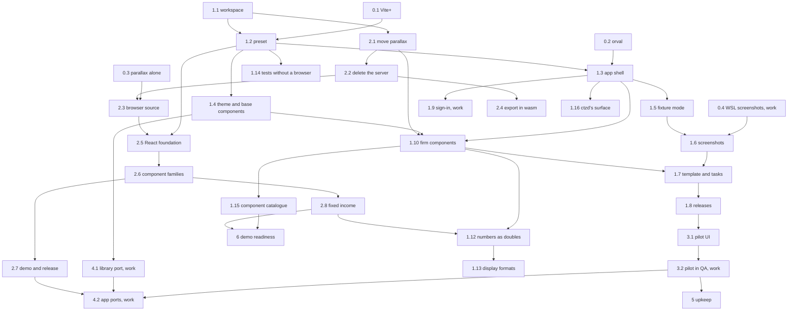
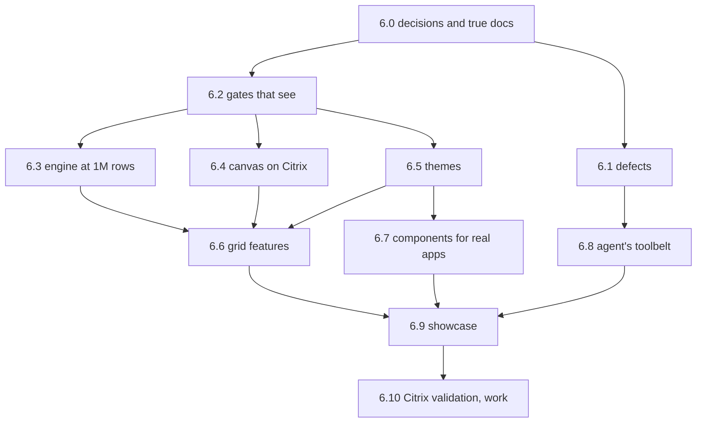

# Roadmap

This roadmap is the build order for basis-ui: seven phases, the steps in each, what each step needs first, and when it
is done. Steps in different lanes run at the same time. For the reasons behind each piece, see [the design](design.md).
basis has [a roadmap of its own](https://github.com/jacobragsdale/basis/blob/main/docs/roadmap.md), and the two meet at
the contract (basis's step 2.5, which this roadmap's step 1.3 builds on) and the pilot (basis's step 2.8 and this
roadmap's step 3.2).

Steps marked **(work)** need the firm's environment: a Citrix desktop, the internal npm feed and Azure DevOps pipelines,
the AKS cluster, the sign-in system, or the Angular library and apps. They are the maintainer's to run or hand on, with
the exact commands to run and what to send back. Every other step runs here, and this repo's own CI runs on GitHub
Actions.

## Lanes

| Lane        | Builds                              | Phases     |
| ----------- | ----------------------------------- | ---------- |
| A. UI       | `@basis/ui`                         | 1, 3, 5, 6 |
| B. Parallax | `@basis/parallax`                   | 2, 6       |
| C. Ports    | the firm's Angular library and apps | 4          |

The critical path runs through lane A: the Vite+ and orval spikes, the workspace, the preset, the shell, fixture mode,
screenshots, the firm's components, the template, and the pilot. Parallax runs alongside phase 1 once the preset exists,
and the ports start at the firm as soon as the base components set the patterns. The eval's UI tasks run in basis's eval
lane, against this roadmap's pilot. Phase 6, demo readiness, runs in both lanes A and B at once, and splits each into
lanes of its own.

## Rules for working in parallel

1. Each step is one branch and one git worktree, named after its id, such as `1.3-app-shell`, and merges to `main`
   through a pull request whose CI is green.
2. Changes to the preset in `@basis/ui` land one pull request at a time, since every app and parallax build on it.
3. Steps in the same package split by module or component family, so that two agents never edit the same files.
4. A step ends with the repo's checks green and its docs updated. A spike ends with its written result in
   `docs/spikes/`.
5. A step marked **(work)** goes to the maintainer as a list of commands to run and what to send back.

## Phase 0: spikes

Every spike runs at once. Each writes `docs/spikes/NAME.md` with the versions it used, a yes or no for each question,
and the fallback for each no.

1. **0.1 Vite+.** Create a React app with `vp create` and answer:
   - which of Oxlint's rules conflict at the design's strictest settings, and which one of each pair to turn off;
   - whether type-aware Oxlint and tsdown's declaration files work on the TypeScript 7.1 beta;
   - whether the React Compiler's `panicThreshold: "all_errors"` fails a build on a component that breaks its rules;
   - whether Oxlint has `no-restricted-imports` and `no-restricted-globals` built in;
   - whether a preset spread into `vite.config.ts` can add `vp run` tasks, and whether `vp create` accepts a template
     from a package;
   - whether Vite+'s hooks install on a fresh clone through `prepare`;
   - whether `@shadcn/lint` runs under `vp lint` through `lint.jsPlugins`, finds components imported from a package
     and the theme in that package's CSS, and whether a token declared in an app's CSS still hides the package's tokens;
   - whether removing Tailwind's palette and blur utilities makes `no-unknown-classes` reject them, and whether `dark:`
     variants can be made a lint error;
   - whether TanStack Form and TanStack Table v9 build under `panicThreshold: "all_errors"`.

   **(work)** On a Citrix desktop, on Windows and in WSL: install `vp` without admin rights, run `vp install` from the
   internal npm feed, and install the hooks on a fresh clone. Done when the result names the exact Oxlint configuration,
   as the preset step 1.2 starts from.

2. **0.2 orval.** Write a FastAPI app with strict models, operation ids taken from handler names, a list endpoint and an
   endpoint that returns Arrow. Generate its client with orval while TypeScript 7 is installed, and check for Zod 4
   schemas that drop unknown fields, TanStack Query v5 hooks, MSW 3 handlers, and a binary response for the Arrow
   endpoint. Done when the result holds the orval configuration step 1.3 uses, and its sample `openapi.json` stands in
   for basis's until basis's step 2.5 publishes one.
3. **0.3 Parallax alone.** Load Arrow bytes into parallax's worker with no server, build `parallax-export` for wasm32
   with rust_xlsxwriter's in-memory mode and save an xlsx from the browser, and measure the largest table that loads and
   pivots within the existing budgets in headless Chromium with software rendering. Measure, too, how long a page with
   one small chart takes to download and compile the wasm and draw the chart. **(work)** Repeat both measurements on a
   Citrix desktop. Done when the result states the row limit and the first chart's time.
4. **0.4 WSL screenshots (work).** Screenshot the same page with the same pinned Playwright Chromium and bundled fonts
   in WSL on two Citrix desktops, and compare. Done when the result says whether baselines made on one desktop hold on
   another.

## Phase 1: @basis/ui

Lane A. Steps 1.3 and 1.4 run at once, and so do 1.8 and 1.9. Steps 1.12 to 1.16 come from ctzd becoming basis-ui's
second consumer on 2026-11-07: 1.12 and 1.13 wait on basis's contract, and 1.14 to 1.16 run at once.

1. **1.1 Workspace.** Set up `packages/ui` in a pnpm workspace, with GitHub Actions CI that runs only the jobs whose
   paths changed, and this repo's own hooks. Done when an empty package passes CI.
2. **1.2 Preset.** Add the Vite+ preset from spike 0.1, as a function that an app's `vite.config.ts` spreads in: the
   Oxlint and Oxfmt configuration with `@shadcn/lint`, the strict tsconfig, the React Compiler with its
   `panicThreshold`, the `vp run` task slots, the library build with tsdown, and Vitest's browser mode with the
   Playwright provider. Needs 1.1 and spike 0.1.
3. **1.3 App shell.** Add TanStack Router and Query; spike 0.2's orval preset and custom fetch, which attaches the JWT;
   a sign-in adapter interface with a fake for tests; error display that reads RFC 9457 problem details; telemetry; and
   the restricted imports and globals that keep feature code on the generated client. Needs 1.2 and spike 0.2.
4. **1.4 Theme and base components.** First the theme, as the design describes it: the ramp generator and its inputs,
   the semantic tokens in both modes, the two densities, the mode and density cookie with the script that applies it
   before the first paint, and the theme's checks. Then the gallery app, with its screenshots in both modes and both
   densities and the axe check. Then shadcn's components on Base UI, one family per agent at once (forms and inputs,
   overlays and menus, navigation and layout, feedback and display), each with its `no-restyle` contract and its gallery
   page. They set the patterns the library port follows. Needs 1.2. The gallery is built in both modes and densities;
   its screenshots' baselines and the axe check came in step 6.2a.
5. **1.5 Fixture mode.** Fixture mode answers from the records in `.fixtures/`, then the synthetic responses in
   `fixtures/`, then orval's MSW handlers. Records and fixtures share basis-ui's record format, which `@basis/ui` ships
   as a JSON Schema for basis's `basis records export` (its step 4.2) to write. `vp dev` starts the app on fixtures on
   a free port per worktree. Needs 1.3.
6. **1.6 Screenshots.** Add `vp run shot ROUTE`, writing a screenshot, the accessibility tree and the console errors.
   Visual baselines are made and compared in WSL only, per spike 0.4, and `vp run check-full` says so on Windows. Add
   the skill for driving an app with Playwright CLI. Needs 1.5 and spike 0.4. `vp run shot` and the skill are built;
   the visual baselines wait for end-to-end tests to return. Open for the maintainer's review: the axe check that the
   design has each shot run, failing on a violation, is not built, since it adds `axe-core` as a new dependency; it
   comes back with the end-to-end tests and gates.
7. **1.7 Template and tasks.** Add the UI repo template as an `@basis/create` package, which `vp create @basis:app`
   reads from a registry, per spike 0.1, with:
   - its managed-file headers and drift check;
   - the `AGENTS.md` block, and the skills with their `.claude/skills/` copy;
   - Vite+'s hooks installed from `prepare`, with a commit hook that runs `vp staged`, `vp check` and `vp test`, since
     Vite+ scaffolds only `vp staged`;
   - a `.gitignore` that names `.fixtures/`, whose records hold client data;
   - the Dockerfile serving the built files, and `azure-pipelines.yml` with a `vp run check-full` stage ready for when
     CI exists;
   - the tasks `client-pull`, `review`, `sync`, `upgrade`, `doctor` and `docs`.

   Needs 1.6 and 1.10. Done when a generated UI repo passes `vp run check-full` in WSL, `vp dev` serves its fixture
   pages, and its image serves the build.
   The template is built and checked here, outside the workspace, against the packed tarballs: `vp run check-full`
   passes, `vp dev` serves its pages in fixture mode, and its Caddy image serves the build with br and gzip, the hashed
   assets immutable, every other path `no-cache`, a missing asset a 404 never cached, and index.html for the app's
   routes. The template ships a sample API, basis's example document with its generated client and fixtures, so the
   shell's home page and two pages calling the API show data in fixture mode before an app has an API, and its
   `AGENTS.md` says how to replace it with `vp run client-pull`. The tasks are built, each failure one `ERROR` line
   ending with its fix: `vp run sync` writes the framework's files from the installed `@basis/ui`, each opening with
   basis-ui's marker, and removes those an earlier version wrote; `vp run check-full` runs `vp run sync --check` first,
   and ends by recording the commit it passed on; `vp run review` prints a pull request's summary for a checked commit;
   `vp run doctor` checks git, the hooks, the installed versions, Playwright's Chromium and `BASIS_API_URL`; `vp run
   docs` lists and prints the installed READMEs' sections; and `vp run upgrade` moves `@basis/ui` and `@basis/parallax`
   to the feed's latest release, or a named one, then syncs and checks. Each ran in a generated repo outside the
   workspace, upgrade against a throwaway local registry; the push hook, which runs `vp run check-full`, has never run
   on a push. Not yet: `vp create @basis:app` needs the registry of 1.8; `check-full` in WSL and on Windows; screenshot
   diffs in `review`, which wait for the visual baselines of 1.6; and the pipeline, which has never run. Decided by the
   orchestrator on 2026-11-07, open for the maintainer's review: pnpm 12 installs a package only once its release is
   `minimumReleaseAge` old, so the app's `pnpm-workspace.yaml` is a framework file whose `minimumReleaseAgeExclude`
   names `@basis/*`, which `vp run sync` keeps in every repo: public packages keep the cooldown, and basis-ui's own
   releases install the day they are out. Not yet checked against a registry: that pnpm then adds no exclusion per
   version on `vp run upgrade`, which the drift check would report.

8. **1.8 Releases.** One tag releases every package, `@basis/create` included, at one version. **(work)** Publish to
   the internal npm feed through Azure DevOps. Needs 1.7. Done when `v0.1.0` installs from git here and from the
   internal feed at the firm.
9. **1.9 Sign-in (work).** Write the adapter for the firm's sign-in system, against the interface from step 1.3. Needs
   1.3.
10. **1.10 Firm components.** Build the components shadcn does not have, one group per agent at once:
    - numbers and dates: the display components, the TypeScript formatter tested against fixtures written by parallax's
      Rust formatter, the number inputs, the as-of date picker and the date ranges;
    - forms: fields bound to orval's Zod schemas, the unsaved-changes guard and typed confirmation, and errors placed on
      the fields a 422's `errors` names, as basis's contract gives them;
    - data: `DataTable` with its row cap, the entity picker, and file import;
    - the shell's parts: sidebar, breadcrumbs, user menu, environment banner, command palette, filter bar, saved views,
      split panes and shortcuts;
    - query states, `Sparkline` and the in-cell bar.

    Each has its gallery page. Needs 1.3, 1.4, and 2.1 for the formatter's fixtures. On 2026-11-08 the shell's parts
    were built but for the filter bar, saved views and split panes: `AppShell`, with the sidebar, breadcrumbs and
    command palette built from routes' `staticData`, the environment banner, the user menu and the shortcut registry
    with its `?` list, used and tested by the example app; t1b built `Sparkline`, `CellBar` and `QueryState`. The
    filter bar was built in step 6.7.2. Not yet: saved views (6.6.3), split panes (6.7), and the forms'
    unsaved-changes guard and typed confirmation (6.7.6).

11. **1.11 Utilities.** Build the four modules the design's Utilities section lists, two agents at once: `dates`, with
    the SIFMA calendar first since the firm trades US fixed income, then the NYSE's and TARGET2's, alongside
    `securities`; then `numbers` and `utils`. `Decimal` is checked against fixtures Python's `decimal` module writes,
    and each calendar against its published holidays. The imports they replace are added to the preset's
    `no-restricted-imports` in a pull request of its own. Needs 1.2.

12. **1.12 Numbers as doubles.** Bring `@basis/ui` to the design's [Numbers](design.md#numbers) rule:
    - `Num`, `Money`, `Pct`, `Bps`, `Price32` and `DataTable`'s number columns take a number, and the decimal-string
      path for API values goes;
    - `Decimal` and its tests against Python's `decimal` go, by the maintainer's choice on 2026-11-07, since no API value needs one;
    - `AmountInput` and its schema return a number: the text is parsed exactly, by moving the decimal point by its suffix's power of ten, then converted.

    In a pull request of its own, as every preset change is, the preset rejects `toFixed`, `toPrecision`, `toLocaleString`, `Math.round` and `Intl.NumberFormat` in app code, each error naming the component to use, and for `Math.round` also `Math.floor` and `Math.trunc` for integers that are not shown. The
    example app's pinned `openapi.json`, fixtures and pages move to basis's float64 contract, along with the
    service-error problem types basis added since the pin. Needs basis's step 2.11 and 2.8.3. Done when no API value
    in the example app is a string of digits and the lint's errors have tests. Built on 2026-11-08, the lint included
    (`eslint/no-restricted-properties`, tested through `packages/consumer`, with `numberText` for numbers in text):
    the components, DataTable, AmountInput and `amountSchema` take and give numbers, `Decimal` is deleted (32nds, tick
    rounding and shares work on exact BigInt digits inside), and the example app runs on basis's float64 document.

13. **1.13 Display formats.** Read the `basis.format` object the design describes:
    - one TypeScript type, shared by `@basis/ui` and parallax, read from an Arrow field's metadata and from
      `x-basis-format` in the API's document;
    - the number components and `DataTable` take it;
    - parallax's grid, pivot and charts format a column by its metadata unless a layout sets a format.

    The example app shows a dataset whose columns format themselves. Needs 1.12, and basis's step 2.13 for real
    metadata; until then the tests write it into their Arrow. Built on 2026-11-08: parallax keeps Arrow field metadata
    and resolves `basis.format` as each column's default format (`parallax-protocol`'s `display`); `@basis/ui` has
    `DisplayFormat`, `readDisplayFormat` and `Formatted`, `DataTable` columns take `format`, and `client-pull` writes
    `displayFormats` from `x-basis-format`; the example's bond page shows its coupon schedule by the Arrow's formats.

14. **1.14 Tests without a browser.** Add a Vitest setup beside `basisTest()`'s Playwright one, for laptops with no
    Chromium, in a DOM implemented in Node. The DOM library is chosen by measuring the gallery's component tests in
    it, and mirrored like the other large packages. `@basis/ui`'s components render and their interactions run there.
    Parallax's components need a canvas and a worker, so under it they render their text alternative and say that
    their pixels need a browser. Done when the example app's tests pass in both setups. Needs 1.2. Built on 2026-11-08:
    happy-dom (it and jsdom both passed Base UI's Dialog, Select, Combobox, Tabs and DataTable; happy-dom ran faster
    with far fewer dependencies), `basisTest({ browser: false })` or `BASIS_TEST_DOM=node`, `@basis/ui/testing`
    (Testing Library, `renderApp`, `mockApi`), and the lint rule that keeps Vitest's browser API in
    `*.browser.test.tsx` files (t18's decision); the example's page tests pass in both runs, CI running the Node one.

15. **1.15 Component catalogue.** `vp run @basis/ui#catalogue` writes a JSON catalogue of every exported component,
    from the source's types and doc comments: its name, what it is for, its props with their types and docs, its
    variants, and one example per family. The catalogue ships in the package, and a test fails when it is stale, when
    a component lacks a purpose or a family an example, or when an example does not type-check. Needs 1.10. Built:
    `catalogue.json`, read by `src/catalogue/` with oxc's parser, 328 components in 74 families and 94 icons, as of
    2026-11-09, each example type-checked in `packages/consumer`.

16. **1.16 ctzd's surface.** Keep working what the design's [Consumers](design.md#consumers) section says ctzd uses:
    - a test app in this repo whose `vite.config.ts`, `tsconfig.json` and `styles.css` are exactly the lines
      `packages/ui/README.md` shows, checked, tested and built in CI (built: `packages/consumer`, held to the README by
      `@basis/ui`'s `readme-config` test);
    - an anonymous sign-in for `BasisApp` (built: `anonymousSignIn()`);
    - a test for each error the preset adds, and for the React Compiler's bail-outs, that the message names its fix
      (built: `tests/preset-errors.test.ts` lints a probe in `packages/consumer`, and `basisPlugins()` wraps the
      compiler so each bail-out opens with an `ERROR` line naming the fix, which `tests/compiler-fixes.test.ts` checks
      in a real build).

    Needs 1.3. Until 1.8 publishes the packages, ctzd installs them from tarballs that `~/dev/basis-ui-dist/pack.sh`
    packs from `main` on the build host.

## Phase 2: parallax in the browser

Lane B. Needs step 1.1 to move in, spike 0.3 for the browser source, and step 1.2 for the React layer. It runs alongside
phase 1.

1. **2.1 Move parallax.** Bring parallax into `packages/parallax` with its history. Its Rust and wasm builds run in CI
   only when its paths change.
2. **2.2 Delete the server.** Remove `parallax-server`, `parallax-sources`, the client's server paths, the registry,
   `/copy` and `/export`, and CI's database containers. Done when the engine, session and protocol tests pass, the
   DuckDB comparisons included.
3. **2.3 Browser source.** Load Arrow bytes from the app, which passes in its load status, and enforce the row limit
   from spike 0.3 with a clear error. Needs 2.2 and spike 0.3.
4. **2.4 Export in wasm.** Move xlsx and CSV export into the wasm build, as spike 0.3 found it works. Needs 2.2, and
   runs alongside 2.3.
5. **2.5 React foundation.** Add the provider, the worker connection and the hooks every component uses. Needs 2.3 and
   1.2.
6. **2.6 Component families.** Port four families at once, one agent each:
   - the grid, with its filters, toolbar, menus and column tools;
   - the pivot, with its group menu and field list;
   - charts, with technical-analysis panes and drawings, the small-data `Chart` API, the text alternative for screen
     readers, and colours read from the theme's tokens;
   - the shared pieces.

   Each family's existing Playwright specs and pixel baselines are rewritten for React. Needs 2.5.

7. **2.7 Demo and release.** Rebuild the demo as a React app on `@basis/ui` with fixture data, with its screenshot tests
   at threshold 0, and delete the Angular layer. Release `@basis/parallax` with the next basis-ui version, which step
   1.8's releases make. Needs 2.4 and 2.6. The demo and the deletion are done: the demo is `packages/parallax-demo`,
   and [the design](design.md#parallax-basisparallax) records what was removed.
8. **2.8 Fixed income.** Seven additions that fit parallax's charts to the firm's desks, from a study of what Aladdin,
   PORT, Yield Book, FactSet, BarraOne, ICE and Marquee show fixed-income portfolio managers and traders. Analytics stay
   in the API, which sends them as columns: curve fits, key-rate durations, scenario P&L and attribution. Parallax
   draws columns, and live updates stay deferred. Needs the charts of 2.6, and runs alongside its other families and
   2.7.

   The additions land one pull request each, in the order below, each on a branch and worktree named after its id. A
   step that needs an earlier one's code branches from that step's branch until it merges. They follow four rules:
   - **Layouts.** Changes are additive and stay at version 2. A new field defaults to what its absence meant and is
     left out of a layout written without it, so the committed fixtures read every layout as before, and a reader that
     lacks the field refuses a layout that sets it, as `deny_unknown_fields` already makes it do. Layouts that set the new fields go in `tests/fixtures/layouts-2.8.json`, which only the React layer reads.
   - **Frames.** A change to frames keeps the native and wasm transcript fingerprints in step.
   - **Data.** `parallax-datagen` writes the data the new views draw, as deterministically as its other datasets:
     `bonds`, a row per bond with its CUSIP, issuer, sector, rating, coupon, maturity, tenor bucket, duration, yield,
     spread, the fitted curve's spread at its duration, DV01 and par; `curves`, Treasury curves on several dates with
     each point's change in basis points; and `attribution`, P&L explained by factor.
   - **Screenshots.** Each new view is a card on a fixed-income page of the charts' end-to-end harness, with its specs
     beside the others in `tests/e2e/charts/` and its screenshots in light and dark at threshold 0.

   The steps:
   1. **2.8.1 Scatter points** (`2.8-scatter-points`). A scatter with at most 5,000 rows in the range shown draws each
      row as a dot; past that, it stays a density. This is the relative-value view, rich or cheap to a curve.
      - Layout: `size`, a numeric column whose magnitude sets each dot's area, such as DV01 or par; `id`, the column
        naming each dot, such as the CUSIP, which titles its tooltip and is what a click selects; `tooltip`, more
        columns the tooltip lists; and `fit`, a column holding the API's fitted curve at each row's x, drawn as a line
        per series. `series` colours the dots and names them in the legend.
      - Engine and session (`chart.rs` in each): `ChartData::Points` below the cap, the points' batch with every value
        as the engine's text and the id as exact JSON, sizes as shares of the largest magnitude in the whole chart so
        that zooming keeps a dot's size, and the fit reduced with M4 in both forms.
      - React: the points' model and painter, hit-testing to the nearest dot, the tooltip, selection through
        `onSelect` with the id column and value, and the text alternative.
      - Tests:
        - Rust: the cap in both directions, the sizes, the frame's texts, and M4's guarantee for the fit line. The
          transcript's scatter becomes points, so both fingerprints change.
        - Unit: the model and hit-testing.
        - Browser: hover and click.
        - End-to-end: a rich/cheap card over `bonds`, with spread against duration, coloured by sector, sized by DV01,
          and the fitted curve. Its specs hover and select a bond.
   2. **2.8.2 Tenor and rating order** (`2.8-orders`). Text keys sort alphabetically, so a DV01 ladder reads `10Y, 1Y,
      20Y, 2Y` and ratings put `A` ahead of `AA`.
      - Layout: `orders` sets a text column's order by name: `"tenor"`, by length, read as `@basis/ui/dates` reads a
        tenor; `"rating"`, best first, on S&P's and Fitch's scale and Moody's; `{"values": [...]}`, as listed; or
        `{"by": "column"}`, by another column's smallest value among a key's rows. Keys an order cannot place come
        after the rest in text order, and nulls last.
      - Where orders apply: group keys at every level, column pivots, flat and detail sorts, a chart's series, and the
        categories of bars, heatmaps and pies. Filters still compare text.
      - The tenor axis: `axis: "tenor"` places an x column of tenors, as text such as `3M` or as years, with the
        engine's ticks labelled `3M` to `30Y`. `tenor_spacing: "even"`, the default, puts the curve's standard tenors
        one step apart and places a value between them by length; `"length"` places it by its length in years.
      - Engine (`dictionary.rs`, `view.rs` and `chart.rs`): ranks per dictionary code for each ordered column, refreshed
        as loads intern strings or change the column an order reads.
      - Tests:
        - Rust: each order, at every level and in column pivots, with top-N's "Other" and nulls; reloads keep the
          order; DuckDB as the oracle, with each order written as an `ORDER BY` expression; tenors read as
          `@basis/ui/dates` reads them, on its test cases; the tenor axis's positions and ticks.
        - Unit: the layout schema.
        - End-to-end: a DV01 ladder card by tenor bucket, and exposure by rating.
   3. **2.8.3 Basis points, 32nds and par amounts** (`2.8-formats`). `@basis/ui`'s `Bps` shows 0.0025 as `25 bp` and
      `Price32` a Treasury price as `99-16+`, but the grid shows 0.0025 and 99.515625, which breaks the design's rule
      that a number reads the same in a card as in the grid. Bond markets write `M` for thousands, yet parallax writes
      `5.0M` for $5 million.
      - Layout: `LayoutFormat` gains `bps`, a rate written in basis points with ` bp` from the fraction it arrives as,
        the only unit rates have (0.0025 is `25 bp`); `thirty_seconds`, a price in 32nds to its finest step (`"thirty_seconds"`, `"halves"`,
        `"quarters"` or `"eighths"`); and `suffixes: "par"`, which writes K/M/B abbreviations as `M`, `MM` and `BN`,
        the suffixes `AmountInput` reads in par style.
      - Code: the Rust formatter (`format.rs`) and its fixtures; `@basis/ui`'s TypeScript port (`format/format.ts`), with
        `Bps` and `Price32` written through it, so that the two agree by construction; parallax's layout schema; value
        axes labelled in the plotted column's format; and the Excel export's number formats, with a Notes sheet line
        for what Excel cannot show, such as 32nds.
      - Tests:
        - Fixtures: the formatter's fixtures gain a group per new format, and `@basis/ui`'s test runs the 2,192 cases
          and the new ones. Every case of those formats reads the same through `Bps` and `Price32`.
        - Rust: exact arithmetic for basis points and for rounding to 256ths, half away from zero, at doubles next to
          each step's midpoint.
        - Export: the read-back tests.
        - End-to-end: the formats on the fixed-income cards' tooltips and axes.
   4. **2.8.4 The SIFMA trading axis** (`2.8-sifma-axis`). The trading axis knows only the NYSE's calendar and its 09:30
      to 16:00 session, while `@basis/ui`'s date pickers default to SIFMA's. Bond markets close on Columbus Day and
      Veterans Day, SIFMA recommends 2 p.m. early closes, and Treasuries trade electronically almost around the clock.
      - Layout: `axis: "trading"` takes `calendar: "nyse" | "sifma"`, NYSE by default as before, and `session: {opens,
        closes}`, the calendar's regular session by default. A session that opens later in the day than it closes
        opens the evening before.
      - Engine (`calendar.rs`): SIFMA's rules and dated exceptions, ported from `@basis/ui/dates`. An early close
        shortens its day on the axis, so closed time still takes no space.
      - Tests:
        - Rust: the SIFMA calendar against the schedules SIFMA published, the same fixture file `@basis/ui/dates` is
          tested against, with the disputes between SIFMA's sources moved into that file so both tests read one list.
          The Rust also writes each year's closes and early closes from 1996 to 2050 to a fixture, which
          `@basis/ui`'s tests check its SIFMA calendar against, as they check the NYSE's, so the two can't disagree
          past the published years.
        - Axis: positions across early closes, an evening session's open, and daylight-saving changes.
        - End-to-end: a 10-year yield on SIFMA's days over October and November, and an intraday card through
          Thanksgiving's early close.
   5. **2.8.5 Waterfall** (`2.8-waterfall`). Attribution and P&L explain.
      - Layout: `kind: "waterfall"` draws the layout's grouped view: each group's bar floats from the running total
        before it to the one after, rising bars in the gain colour and falling ones in the loss colour, joined by
        connectors and ending in a total bar.
      - Engine (`aggregate.rs` and `view.rs`): `show_as: "running_total"`, Excel's "Running Total In": among siblings
        in their order, from exact sums, for sums and counts only. A waterfall adds it for its first measure.
      - Labels: each bar's value and the total are the engine's text.
      - Tests:
        - Rust: running totals against DuckDB's window sums, after reloads as a diff too, and refused for aggregates
          that do not add.
        - Unit: the model.
        - End-to-end: a P&L explain card over `attribution`, where a click selects a factor.
   6. **2.8.6 Yield curves with a change pane** (`2.8-curve-change`). Curves for several dates as lines, with the
      change in basis points as bars below, on the same tenor axis. Needs 2.8.2's tenor axis.
      - Layout: `panes`, a list of panes under the plot, each with its columns, `line` or `bar`, and a title. They
        share the x axis, the crosshair and zoom, as the indicators' panes do, which they generalise to any value
        axis. A series with no values in a pane is left out of it.
      - Code: `model-panes.ts` in React, and the session's frames for pane columns.
      - Tests:
        - Rust: the frame.
        - Unit: the panes' model.
        - End-to-end: a card of three dates' curves with the change below, and a crosshair spec across the panes.
   7. **2.8.7 Reversed axis and the rising colour** (`2.8-reversed-axis`). A rising yield is a loss to a long position.
      - Layout: `reverse_y`, `reverse_y_right` and a pane's `reverse` turn an axis upside down. `rising: "gain" |
        "loss"` says which colour a rise takes: candles, OHLC bars, volume, MACD's histogram, change bars and waterfall
        steps.
      - Tests:
        - Unit: the model, and drawings, zoom and brushing on a reversed axis.
        - End-to-end: a yield chart drawn reversed.

   Each step updates parallax's design page and its README's API table as it builds. Done when the seven are merged.

## Phase 3: the pilot

Lane A, with basis's lane B.

1. **3.1 Pilot UI.** Create a pilot UI repo from the template, pull basis's pilot API's `openapi.json` with `vp run
   client-pull`, and build a page of each kind, including a parallax page once step 2.7 is done. Needs 1.8 and basis's
   step 2.7.
2. **3.2 Pilot in QA (work).** Deploy the pilot UI and basis's pilot API to QA through their generated pipelines, behind
   one host if basis's spike 0.4 allows it. Basis's eval lane adds UI tasks and runs them against the pilot. Needs 3.1
   and basis's step 2.8. Done when the UI reaches QA in one pipeline run and the loop time is recorded against the
   hook's one-minute budget.

## Phase 4: the Angular library and apps

Lane C (work).

1. **4.1 Library port.** Inventory the Angular library, then port one component family per agent at once. Each family is
   compared by screenshot with its Angular original on the same fixture. Needs 1.4.
2. **4.2 App ports.** Port one app per agent, all at once. Needs step 3.2, the component families from 4.1 that each app
   uses, and step 2.7 for apps with grids or charts. For each app:
   1. Create fixtures for every API call the app makes.
   2. Screenshot every route of the Angular app on those fixtures.
   3. Port the app to a basis-ui repo. An app whose backend is an existing service keeps that service: `vp run
      client-pull` takes its OpenAPI document, or a hand-written one if the service has none.
   4. Compare screenshots with a tolerance, and run the same role-based Playwright specs against both versions.
   5. Keep a `PORTING.md` log, as optim's port skill does, and cut over when the screenshots and specs match.

   No app ever mixes Angular and React.

## Phase 5: upkeep

Lane A. Needs step 3.2.

1. **5.1 Cleanup.** Add a golden-principles file to the synced files, and a scheduled cleanup agent that opens
   refactoring pull requests against it, each gated by the screenshot tests.
2. **5.2 Tuning by eval.** Every release runs the eval's UI tasks. An error message, skill or doc page changes only when
   the eval shows the change helps.
3. **5.3 TypeScript 7.1.** Pin TypeScript 7.1 stable in every package and the template, if a release has not already
   done it.
4. **5.4 CI (work).** When the firm builds CI, turn on the generated pipeline's `vp run check-full` stage, and add a
   branch policy on `main` that requires it.

## Phase 6: demo readiness

Lanes A and B. This phase takes basis-ui from "the checks are green" to a demo for both the people who build the
firm's UIs and the people who use them: a fixed-income workbench, made from the template as any app is, with a
blotter of 1,000,000 trades and a pivot over 1,000,000 positions that run fast on a Citrix desktop with no GPU. It
comes from a review of the whole repo on 2026-11-09, and carries out the decisions the maintainer made that day, which
[the design](design.md) records. [PLAN.md](../PLAN.md) holds each step's detail, its findings, its targets and its
measurements, until the phase is done, then is deleted; this section is the summary.

By the maintainer's choice on 2026-11-09, Phase 6's steps push straight to `main`, after a fetch, a rebase onto
`origin/main` and the checks, rather than merging through a pull request. Every other rule for working in parallel
holds: a branch and worktree per step, named after its id, and the preset's changes one at a time, so the steps of 6.8
run in order.

Steps 6.1 and 6.2 run at once, then 6.3, 6.4, 6.5 and 6.8, each in a lane of its own:

| Lane       | Builds                                                 | Steps    |
| ---------- | ------------------------------------------------------ | -------- |
| Rust       | parallax's engine, in `packages/parallax/crates/`      | 6.3      |
| Grid       | parallax's TypeScript, in `src/grid/` and `src/chart/` | 6.4, 6.6 |
| Theme      | `@basis/ui`'s theme, then parallax's                   | 6.5      |
| Components | `@basis/ui`'s components and shell                     | 6.7      |
| Preset     | `@basis/ui`'s preset and catalogue                     | 6.8      |

Step 6.6 waits for 6.3 and 6.4, since it edits the painter and reads the engine's statistics, and for 6.5's scales. The
showcase comes last on purpose: an agent builds it with only the shipped tools, and each place it stumbles becomes a
fix in 6.8.

0. **6.0 Decisions and true docs** (`6.0-decisions`). The design records the decisions of 2026-11-09, this phase joins
   the roadmap, and each line of the docs that claimed something not built says so, with the step that builds it.
   Built on 2026-11-09: the design's theme, toolchain and parallax sections, "Decided against", the facts and "Not yet
   verified" carry the decisions; the design, the roadmap, `@basis/ui`'s README and parallax's design and theming pages
   mark what is not built as "not yet", with its step.
1. **6.1 Defects.** Four branches at once, one per package area, each fix a failing test first: `@basis/ui`'s
   components (`6.1a-component-defects`), the preset's tasks (`6.1b-task-defects`, which lands before 6.8 starts),
   parallax's TypeScript (`6.1c-parallax-defects`) and parallax's Rust (`6.1d-engine-defects`). 6.1d built on
   2026-11-09: a reload's old rows stay only until the open views that need them apply them, and a decimal or
   timestamp too large to load is refused as an overflow. 6.1a built on 2026-11-09: the shell is one column under its
   banner and takes the gallery's preferences, the pickers count from today as they open, a table reports its
   selection's ids again on new data, plain keys yield to controls and dialogs, and bad data shows `—`. 6.1b built on
   2026-11-09: `vp run shot` uses only its own app's `vp dev`, shows its output and waits on no idle network,
   `check-full` checks the fixtures and builds, `sync` removes only what it retired, and the example passes its check.
   6.1c built on 2026-11-09: a layout update at rest waits for its answer, a grid shows its last row whole, keeps the
   rows on screen over a late frame and the focus above its totals, and says when its container gives it no height,
   and labels read the theme's OKLCH colours.
2. **6.2 Gates that see.** Three branches at once, so that every later step is judged by them:
   - **6.2a** (`6.2a-gallery-shots`): a screenshot of each gallery section in every theme, mode and density, compared
     with baselines in the pinned Playwright image by `vp run @basis/gallery#shots`, an axe check on each, a render
     matrix test, and a gallery page of the tokens. Built on 2026-11-09: each of the gallery's 84 sections is shot
     alone, its overlays open and its hovered, focused and pressed examples forced, in light and dark, comfortable and
     compact, against 336 baselines, with axe on each, `axe-core` pinned with the maintainer's approval;
   - **6.2b** (`6.2b-scale-harness`): `vp run @basis/parallax#bench`, a harness that measures load, sort, filter,
     search, pivots and drawing at 150,000, 1,000,000 and 2,000,000 rows against budgets, with a phase profile of the
     engine, written up in `docs/spikes/scale-1m.md`. Built on 2026-11-09: the harness runs the package's build with
     its limits raised outside the API, plain and throttled, against host and nightly budgets, and the engine's
     `profile` feature splits the load and the reference pivot into phases; today's figures agree with the review's
     within the shared host's noise;
   - **6.2c** (`6.2c-bundles-and-motion`): `@basis/ui` that tree-shakes, `vp run budget` for each route's bundle, lazy
     routes, and motion that suits a desktop drawn on the CPU, with a `motion` preference beside mode and density.
     6.2c built on 2026-11-09: an app bundles only the components it imports, `vp run budget` holds each route to its
     budget, the template's pages load lazily, veils appear at once and a change of preferences in one frame, and the
     user menu offers reduced motion; the 200 kB target for the consumer's one card is missed at 543 kB, as React DOM
     alone is 207 kB.
3. **6.3 The engine at 1,000,000 rows.** Lane Rust, one branch per sub-step in order, each starting and ending with the
   harness: a load that copies once (`6.3.1-load`), a progressive load (`6.3.2-progressive-load`), sorts on keys
   (`6.3.3-sort`), filters as kernels (`6.3.4-filter`), a typed group-by (`6.3.5-group-by`), no rebuild where the order
   alone changes (`6.3.6-rebuilds`), memory that comes back (`6.3.7-release`), narrower storage and build flags
   (`6.3.8-storage-and-flags`), and the new limit in bytes (`6.3.9-limit`). 6.3.1 built on 2026-11-09: the engine
   reads the page's stream a batch at a time into columns sized once and keeps them as a first load's table, so
   1,000,000 trades load fully in 3.2 s throttled, from 7.9 s, missing 3 s, and 0.87 s plain, from 2.8 s, in 242 MB of
   WebAssembly, from 995 MB. 6.3.2 built on 2026-11-09: a response's body reaches the engine chunk by chunk, a first
   load publishes its rows as they arrive, and `useDataset` reports `progress`, so 1,000,000 trades show their first
   rows in 1.7 s throttled, from 3.5 s, missing 1 s, and 0.24 s plain, from 0.97 s; fully loaded they take 0.72 s plain,
   from 0.97 s, and 4.1 s throttled, from 3.5 s, as the download, the load and the drawing share the quota. 6.3.3 built
   on 2026-11-10: a flat view sorts on an integer key for each row, a radix sort, and the table keeps each order for its
   current rows, so a toggle takes its runs backwards and a filter walks it: a first sort of a text or decimal column of
   1,000,000 trades takes 73 to 130 ms throttled, from 2.1 to 2.2 s, and 29 to 31 ms plain, from 0.5 s; a toggle 39 to
   49 ms throttled, from 1.3 to 2.1 s; a filter under a sort 98 to 119 ms, from 682 ms, missing 50 ms by the filter's
   own cost, which 6.3.4 takes on. 6.3.4 built on 2026-11-10: a flat view's filters test a column's rows in a loop for
   each type and operator into words of bits, a text column deciding each dictionary code once, and the table keeps the
   last filters' words, so a filter of 1,000,000 trades takes 31 to 71 ms throttled, from 72 to 170 ms, a search 32
   to 40 ms, from 331 ms, and a filter under a sort 31 and 38 ms, from 108 ms, meeting 100 and 50 ms. 6.3.5 built on
   2026-11-10: a leaf key of text and boolean columns packs into one integer, and counts and exact sums add up in flat
   arrays a measure at a time, so the reference pivot of 1,000,000 positions builds natively in 0.14 to 0.22 s, from
   0.55 s, and in the browser in 205 ms plain, from 516 ms, and 867 ms throttled, from 1,702 ms, missing 300 ms. 6.3.6
   built on 2026-11-10: a pivot keeps its tree when its groups' order, value filter, ranking or depth changes, and each
   node's child order once worked out, so expand all on 1,000,000 positions takes 71 ms throttled, from 1,042 ms, and
   collapse all 20 ms, from 799 ms. 6.3.7 built on 2026-11-10: a dataset no component shows is unloaded, components
   share one load of the same data, and a worker whose memory outgrew its tables is replaced once idle. 6.3.8 built on
   2026-11-10: a decimal column holds a word a value until one does not fit, so the 1,000,000 positions take 449 MB of
   WebAssembly, from 531, and the browser's build is optimised as one unit with SIMD, a module of 4.69 MB, from 5.17;
   narrower text codes, packed booleans, no sequence for a table with no key and `wasm-opt` were measured or weighed
   and left. 6.3.9 built on 2026-11-10: a table holds 500 MB of Arrow, about 1,000,000 rows of 40 columns, and
   10,000,000 rows, from 150,000 rows and 70 MB, and the demo's positions and trades are 1,000,000 rows each.
4. **6.4 The canvas on a Citrix desktop.** Lane Grid, one branch per item in order: digits that line up
   (`6.4.1-tabular-digits`), whole device pixels (`6.4.2-device-pixels`), one draw per frame and one row step per notch
   (`6.4.3-frame-aligned`), a scroll that moves pixels (`6.4.4-scroll-blit`), rows past the scrollbar's reach
   (`6.4.5-row-position`), less work in a pass (`6.4.6-paint-cost`), selection that does not count rows
   (`6.4.7-selection`), and the charts' costs (`6.4.8-chart-cost`). 6.4.1 built on 2026-11-09: the canvases draw in
   `--font-num`, Inter declared again with tabular figures on, at `@basis/ui`'s text sizes, 14 px in cells and 12 on
   axes, as the DOM's numbers are. 6.4.2 built on 2026-11-09: every canvas is sized from `devicePixelContentBoxSize`
   in whole device pixels, its rules and gridlines land on them, it sizes again when the ratio changes, and tests and
   screenshots run in Chromium at 1.25 and 1.5. 6.4.3 built on 2026-11-09: the grid and the pivot draw once an animation frame however many
   events arrive in it, a mouse's notch moves three rows at once and paints once, a trackpad's pixels stay smooth, and
   the bench starts Chromium at each ratio, since an emulated ratio, not the painter, made the throttled drawing at 1.25
   and 1.5 cost 5.5 ms. 6.4.4 built on 2026-11-10: a scroll by rows or across copies the pixels that stay through a
   scratch canvas and paints only what it exposed, so scrolling 1,000,000 trades three rows a frame repaints 9 % of the
   canvas, from all of it, at every ratio; throttled, the drawing is 1.8, 1.9 and 3.1 ms a frame at 1, 1.25 and 1.5,
   from 1.8, 2.3 and 2.8, within the 8 ms target, and the main thread is busy 3.9, 5.2 and 7.9 ms a frame, from 4.5,
   6.2 and 8.5, since the copy moves every pixel that stays. 6.4.5 built on 2026-11-10: past the scrollbar's native
   reach the grid aims a row's offset at the middle of its share of the scrollbar, so at 125 % the keyboard reveals
   every row of 1,000,000, where one in twenty landed a row early. 6.4.6 built on 2026-11-11: a cut text is fitted by
   halves, a few measurements where it took one for each character dropped; a pass with the frame and search it last
   drew walks only the rows the selection, the pointer or the choice of rows moved over, and reads whether a row is
   chosen once for the row; each area of columns is clipped once for all the rows, not twice a row; and moving along
   the header repaints the header alone. Scrolling 1,000,000 trades draws 1.0, 1.2 and 1.4 ms a frame at 1, 1.25 and
   1.5, from 1.1, 1.3 and 1.8, and 1.0, 1.5 and 2.3 throttled, from 1.5, 1.8 and 2.4. No pixel changed. 6.4.7 built
   on 2026-11-11: the grid holds every row but some as well as some rows, so the header's checkbox chooses every row
   of a flat view without fetching a key, past 1,000,000 rows as below, and a toggle no longer rebuilds the set;
   `onRowsChange` hands an app the choice as `RowsChosen`, while `onSelectionChange` and `selected` as keys keep their
   contract.
5. **6.5 Themes.** Lane Theme, one branch per item in order: tokens for what opacity fakes (`6.5.1-tokens`), density
   in whole pixels (`6.5.2-density`), `defineTheme` (`6.5.3-define-theme`), `checkTheme` (`6.5.4-check-theme`), the
   choice of theme in the cookie (`6.5.5-theme-preference`), parallax on the same theme (`6.5.6-parallax-theme`), the
   default's identity and two more themes (`6.5.7-identity`), and the studio in the gallery (`6.5.8-studio`).
   6.5.1 built on 2026-11-09: no colour class takes an opacity modifier, which a test holds, since hovered and pressed
   fills, edges, the veil, a control that is off and a disabled field are tokens, the focus ring is a solid outline
   whose width and gap are variables, and durations, layers, the pill radius, the disabled fade and the shadows are
   named scales. 6.5.2 built on 2026-11-09: each density gives controls whole-pixel heights, paddings, icons and gaps
   of their own, Button's four sizes differ in both, and the stylesheet's base is the compact default, which a gallery
   test measures on every control. 6.5.3 built on 2026-11-09: a theme is one file of `ThemeInputs`, from each hue's
   curve to the chart palettes, the generator is pure functions of it, the default sits at `:root` and any other under
   `[data-theme]` with its dark mode on, around or inside it, `vp run @basis/ui#theme new NAME` starts one, and the
   default's stylesheet computes as it did. 6.5.4 built on 2026-11-09: `checkTheme` holds every shipped theme in `vp check`, through the
   repo's lint rule `basis-ui/check-theme`, to text at 5.5:1 on every surface and fill it sits on, the focus ring as
   drawn at 3:1, and every pair of chart series apart under each simulation, each failure ending with the nearest value
   that passes; the default's light green solid and gain, dark red and amber solids, dark ring, gain and loss, and
   chart colours moved to pass it. 6.5.5 built on 2026-11-09: the cookie holds the theme, which the head script puts
   in `data-theme` before the first paint and an unknown name reads as the default, the user menu offers the
   generator's themes once more than one ships, `BasisApp`'s `preferencesDomain` puts the cookie on the parent domain,
   a page follows another app's change through the cookie store's change event and, without one, on focus, and
   `vp run shot --theme` takes any shipped theme. 6.5.6 built on 2026-11-10: parallax drops the 13 tokens nothing read
   and `standardTheme`, `airyTheme` and `densityStep` from its API; `vp run @basis/ui#theme` writes its chart colours,
   held to the generator by a test; `basisTheme` sizes rows, the header, padding and the header's icons by
   `@basis/ui`'s control lengths, so rows are 28 px compact and 32 comfortable, from 24 and 30, and takes the bars'
   radius, the focus ring's width, the label line height and the two inks from the theme; canvases read their tokens
   again when a theme, density or `dark` class changes on any element, a stylesheet is swapped, or
   `applyPreferences`'s `basis:themechange` event fires, and a grid fits its columns again when its padding or icons
   change.
6. **6.6 Grid features.** Lane Grid, after 6.3, 6.4 and 6.5, one branch per item: rich cells (`6.6.1-rich-cells`), a
   context menu and events (`6.6.2-context-menu`), saved views (`6.6.3-saved-views`), layouts typed by the dataset's
   rows (`6.6.4-typed-layouts`), states on the canvas (`6.6.5-states`), and small charts that say what their marks are
   (`6.6.6-chart-finish`).
7. **6.7 Components for real apps.** Lane Components, after 6.5.1 and 6.5.2, one family per branch in order: the shell
   (`6.7.1-shell`), the filter bar (`6.7.2-filter-bar`), `DataTable` (`6.7.3-data-table`), `StatCard`
   (`6.7.4-stat-card`), dates (`6.7.5-dates`), forms (`6.7.6-forms`), choosing (`6.7.7-choosing`), display
   (`6.7.8-display`), long lists (`6.7.9-long-lists`), and one vocabulary of props (`6.7.10-vocabulary`).
   6.7.1 built on 2026-11-09: `AppShell` has slots for its header and the sidebar's header and footer, an icon rail,
   groups in its navigation and one tooltip delay; each page is a `Page`, with its title, description and actions over
   content that scrolls or fills the window, whose `breadcrumb` titles the last breadcrumb from a query's data; the
   palette's commands take keywords, a group, an icon and a shortcut; the page shown is a shortcut scope, and a
   conflict logs an `ERROR` line; a repeated `toastError` counts on its open toast; and parallax's demo runs on the
   shell, with its palette, shortcuts and breadcrumbs. 6.7.2 built on 2026-11-09: `FilterBar` filters a page's rows by
   text, a choice, several choices, a range of days and a range of numbers, on `@basis/ui`'s Select, Combobox,
   DateRangePicker and AmountInput, with a chip for each active filter and Clear all; `defineFilters` declares the
   filters, `filterSearchSchema` gives the route its Zod `validateSearch`, `useFilters` reads and writes the address,
   and `filterRows` keeps the rows. Back and Forward restore the filters, and typing is one history entry. Its
   `FilterValues` are the seam for saved views (6.6.3), which restore them with `setAll`, and for the controlled
   `DataTable` (6.7.3). The example app's conventions page filters its table with it. 6.7.3 built on 2026-11-10:
   `DataTable`'s sort, text filter, hidden columns, page and selected ids can each be the app's, with its change and a
   default; `filterBy` takes a FilterBar's values; it pages 50 rows unless told otherwise, memoises its rows, draws a
   row's checkbox and actions button as the browser's own and its menus when they open, filters by the text its cells
   show once typing pauses, and has `onRowClick`, a header that stays in view and column widths. With the CPU slowed
   four times, at its row cap, before and after: the first render's longest frame 3.9 to 8.3 s, now 267 to 346 ms
   alone (target 200 ms, missed: PLAN.md, "Found while building"); a key in the filter 1.0 to 1.4 s, now 96 to 159 ms;
   a change of mode 3.1 to 4.1 s, now 146 to 171 ms.
8. **6.8 The agent's toolbelt.** Lane Preset, in order, since preset changes land one at a time: a catalogue that
   answers, with `vp run docs NAME` (`6.8.1-catalogue`), lint that costs fewer rounds (`6.8.2-lint-limits`), the doors
   that are open (`6.8.3-closed-doors`), one verdict, `vp run verify` (`6.8.4-verify`), a shot that explains itself
   (`6.8.5-shot`), scaffolds, `vp run new` (`6.8.6-new`), checks that read code, for ctzd (`6.8.7-check-routes`),
   upgrades (`6.8.8-upgrade`), the template proven in CI (`6.8.9-template-ci`), and skills (`6.8.10-skills`).
   6.8.1 built on 2026-11-09: `vp run docs NAME` prints a component, hook, function, type or module from the catalogue
   in about 60 lines, `--search` finds one by purpose and `--json` prints either, the catalogue lists the props each
   component takes from Base UI, every type an entry names, the hooks and functions, the subpath modules and parallax's
   components, hooks and `LayoutInput` fields, each prop held to the component by a type-checked probe, and the README
   keeps what an app needs, with a changelog, while `CONTRIBUTING.md` holds the rest.
   6.8.2 built on 2026-11-09: in app code the six limits a table page failed are loosened or off, as the design lists,
   while basis-ui's own code keeps them, and `no-restyle`, the `fetch` ban and the raw-colour errors name the variants,
   `vp run docs NAME` and the tokens meant, with nothing after them that contradicts them.
   6.8.3 built on 2026-11-09: the doors probes found open fail, each with an `ERROR` line that ends in its fix, in app
   code only: comments that turn a check off, but `oxc/no-barrel-file` in `src/api`, refused by the lint and read as
   text by `check-full`, now `verify`, and counted by `vp run review`; a plain element's `dark:`, `!`, selector variants, filters,
   black and white and template-string classes; dates and rounding by hand; every network API, `fetch` in `src/api`
   among them; the libraries the design rejects; and, in the drift check, `src/styles.css`, `tsconfig.json`,
   `vite.config.ts`, `.gitignore`, now a framework file, and the dependencies an app may have.
   6.8.4 built on 2026-11-09: `vp run verify` runs sync, client, fixtures, config, lint, types, tests, build, budget
   and suppressions, each to its end, then prints one summary, each failure the stage's `ERROR` line with its file and
   line, or with `--json` one line of `VerifyReport`, read from each tool's machine format; `--stage NAME` runs some.
   The commit hook runs the fast stages, about 3 s in `packages/example`, and the push hook every stage, about 18 s;
   `check-full` is an alias that says so, and `packages/consumer`, with a test now, passes it as a ctzd app.
   6.8.5 built on 2026-11-09: `vp run shot` writes, beside the picture, the accessibility tree and the console, each
   request to `/api` with its status and source, named by fixture mode's headers, and axe's check, a violation failing
   it, with Base UI's four known exceptions by rule and selector. It takes `--mode`, `--density`, `--theme default`,
   `--selector`, several routes, `--all` from the router, steps (`click`, `hover`, `type`, `press`, `wait`), `--compare`
   with Playwright's comparator, and `--json`, one line of `ShotReport`. In `packages/example` it finds the shell's
   two `main` landmarks and its sidebar outside any landmark, left to the shell's step.
   6.8.6 built on 2026-11-09: `vp run new table|page|form NAME --operation ID` writes a page from the operation's
   schema, a DataTable with a column for each field of a row, a card of the fields, or a form bound to the generated
   Zod schema, each number by its display format, with its test, a fixture and its route, which pass the app's lint,
   types and tests as written, then prints `vp run verify` and `vp run shot /NAME`. An unknown operation fails with the
   closest ids, and an existing file with `--force`. `vp run fixtures check` checks each fixture's body against its
   schema as the client reads it, and `vp run fixtures new OPERATION [--status N]` writes one the schema accepts.
   6.8.7 built on 2026-11-09: `checkRoutes(routeTree, { params, signIn })` in `@basis/ui/testing` makes one test per
   route, rendered in `BasisApp` in happy-dom on `fixtures/`, matched as fixture mode matches them, then the generated
   handlers. Through a setup file `basisTest()` adds, the fixture-mode plugin gives it the fixtures and the values each
   one's path gives its operation's path parameters. It fails with an `ERROR` line for each request nothing answers,
   in fixture mode's words; each error reported to telemetry, raised by `toastError` or written to the console; a page
   still loading after 10 s; and each axe violation. A route with a parameter opens at a fixture's value, by path or by
   the parameter's name, as `vp run new` names it, or is skipped with a line. `expectAccessible(container?)` runs the
   same check anywhere. axe in a test runs `vp run shot`'s rules and Base UI's exceptions, less those that measure the
   drawn page (`color-contrast`, `link-in-text-block`, `target-size`, `scrollable-region-focusable`) and those that read
   `index.html`, in Chromium as in happy-dom. `packages/example` and the template call it in `src/routes.test.ts`; on
   the example its three routes take 0.6 s in happy-dom, 1.7 s for the file.
   6.8.8 built on 2026-11-10: `vp run upgrade [VERSION]` refuses a tree with changes not committed, or an app linked to
   the workspace, says so when the installed version is the latest, refuses an older one, then installs `@basis/ui`
   and `@basis/parallax` at one version, prints the new version's changelog entries after the installed one, runs
   `vp run sync`, the codemods the releases in between ship, oldest first, and `vp run verify`, and ends with a
   summary of what it did and each entry's "What to do:". `--dry-run` installs the release in a temporary folder with
   the app's `.npmrc`, prints the same with each codemod's change line by line, and changes nothing. The changelog's
   headings are `## Unreleased` and `## VERSION - YYYY-MM-DD`, read by `src/preset/changelog.ts` and held by a test; a
   codemod is `src/codemods/VERSION/NAME.ts`, built to `dist/codemods/`, exporting a transform over the app's files
   that git tracks, `unreleased/` until a release renames it. The first, `fetch-rule-name`, renames
   `eslint/no-restricted-globals` to `basis/no-fetch` in disable comments, found by Oxc's parser from `vite-plus`. The
   tests run the task against a fake `vp` and a feed of folders, on a temporary git clone. Not yet: an upgrade from a
   version older than this one runs that version's `upgrade`, without codemods; none was released.
   6.8.9 built on 2026-11-10: `vp run @basis/create#prove` packs `@basis/ui`, `@basis/parallax`, its engine built in
   the tarball, and `@basis/create`, makes an app from the packed template in a temporary folder outside the
   workspace, as `vp create` copies an org template, installs it from the tarballs through a pnpmfile outside the
   app, commits it through its hook, and runs `vp run verify`, `vp run shot --all` and `vp build`, then checks git has
   nothing left to commit; a stage that fails names itself in one `ERROR` line. CI's `template` job runs it when
   `packages/ui`, `packages/parallax/src`, `packages/create` or the workflow changes, every step with a timeout, and
   Playwright's install, in every job, three minutes and once more. The template failed one way: a packed package drops
   its `.gitignore`, so the app had none, failed the sync stage, and its lint read `node_modules` until it was killed;
   the template holds it as `_gitignore`, which `vp create` renames. The root's lint still skips the template, which is
   linted as the app made from it, by its own configuration. Not yet: `vp create @basis:app` itself, which needs 1.8's
   registry.
9. **6.9 The showcase** (`6.9-showcase`, then a branch per page). `packages/showcase`, made from the template, with ten
   pages: overview, blotter, positions, relative value, P&L explain, curves, a bond, booking a trade, import, and a
   probe of the desktop. An agent builds it with only the shipped tools, and logs in `BUILDING.md` each place they fell
   short.
10. **6.10 Citrix validation (work).** The maintainer runs the built showcase on a Citrix desktop and sends back the
    probe's and the performance overlay's reports and screenshots. The limit, the budgets and the motion defaults are
    then set from the desktop's figures. This is spike 0.3's Citrix repeat, on the new engine.
