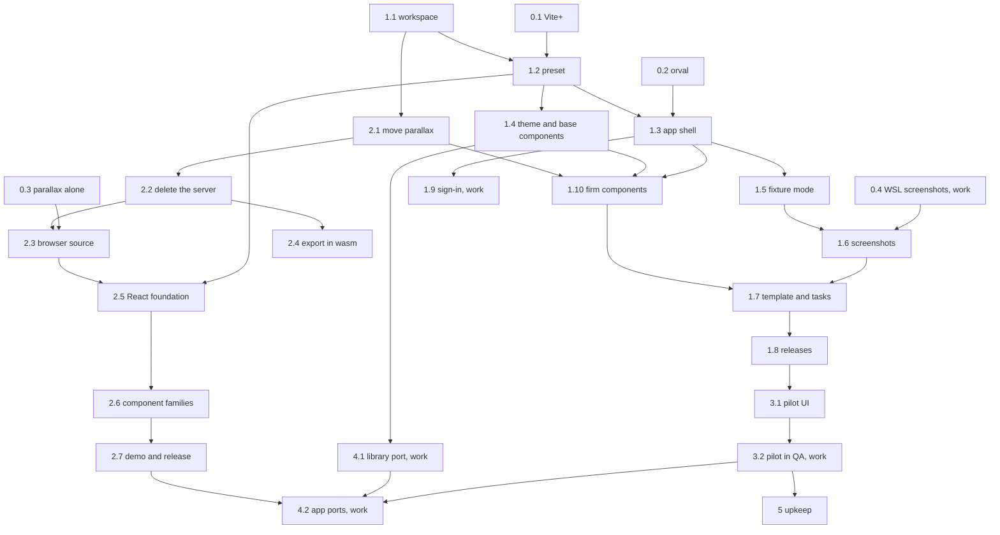

# Roadmap

This roadmap is the build order for basis-ui: six phases, the steps in each, what each step needs first, and when it is
done. Steps in different lanes run at the same time. For the reasons behind each piece, see [the design](design.md).
basis has [a roadmap of its own](https://github.com/jacobragsdale/basis/blob/main/docs/roadmap.md), and the two meet at
the contract (basis's step 2.5, which this roadmap's step 1.3 builds on) and the pilot (basis's step 2.8 and this
roadmap's step 3.2).

Steps marked **(work)** need the firm's environment: a Citrix desktop, the internal npm feed and Azure DevOps pipelines,
the AKS cluster, the sign-in system, or the Angular library and apps. They are the maintainer's to run or hand on, with
the exact commands to run and what to send back. Every other step runs here, and this repo's own CI runs on GitHub
Actions.

## Lanes

| Lane | Builds | Phases |
|---|---|---|
| A. UI | `@basis/ui` | 1, 3, 5 |
| B. Parallax | `@basis/parallax` | 2 |
| C. Ports | the firm's Angular library and apps | 4 |

The critical path runs through lane A: the Vite+ and orval spikes, the workspace, the preset, the shell, fixture mode,
screenshots, the firm's components, the template, and the pilot. Parallax runs alongside phase 1 once the preset exists, and the ports start at
the firm as soon as the base components set the patterns. The eval's UI tasks run in basis's eval lane, against this
roadmap's pilot.

## Rules for working in parallel

1. Each step is one branch and one git worktree, named after its id, such as `1.3-app-shell`, and merges to `main`
   through a pull request whose CI is green.
2. Changes to the preset in `@basis/ui` land one pull request at a time, since every app and parallax build on it.
3. Steps in the same package split by module or component family, so that two agents never edit the same files.
4. A step ends with the repo's checks green and its docs updated. A spike ends with its written result in
   `docs/spikes/`.
5. A step marked **(work)** goes to the maintainer as a list of commands to run and what to send back.

## Phase 0: spikes

Every spike runs at once. Each writes `docs/spikes/NAME.md` with the versions it used, a yes or no for each question,
and the fallback for each no.

1. **0.1 Vite+.** Create a React app with `vp create` and answer:
   - which of Oxlint's rules conflict at the design's strictest settings, and which one of each pair to turn off;
   - whether type-aware Oxlint and tsdown's declaration files work on the TypeScript 7.1 beta;
   - whether the React Compiler's `panicThreshold: "all_errors"` fails a build on a component that breaks its rules;
   - whether Oxlint has `no-restricted-imports` and `no-restricted-globals` built in;
   - whether a preset spread into `vite.config.ts` can add `vp run` tasks, and whether `vp create` accepts a template
     from a package;
   - whether Vite+'s hooks install on a fresh clone through `prepare`;
   - whether `@shadcn/lint` runs under `vp lint` through `lint.jsPlugins`, finds components imported from a package
     and the theme in that package's CSS, and whether a token declared in an app's CSS still hides the package's tokens;
   - whether removing Tailwind's palette and blur utilities makes `no-unknown-classes` reject them, and whether `dark:`
     variants can be made a lint error;
   - whether TanStack Form and TanStack Table v9 build under `panicThreshold: "all_errors"`.

   **(work)** On a Citrix desktop, on Windows and in WSL: install `vp` without admin rights, run `vp install` from the
   internal npm feed, and install the hooks on a fresh clone. Done when the result names the exact Oxlint configuration,
   as the preset step 1.2 starts from.
2. **0.2 orval.** Write a FastAPI app with strict models, operation ids taken from handler names, a list endpoint and an
   endpoint that returns Arrow. Generate its client with orval while TypeScript 7 is installed, and check for Zod 4
   schemas that drop unknown fields, TanStack Query v5 hooks, MSW 3 handlers, and a binary response for the Arrow
   endpoint. Done when the result holds the orval configuration step 1.3 uses, and its sample `openapi.json` stands in
   for basis's until basis's step 2.5 publishes one.
3. **0.3 Parallax alone.** Load Arrow bytes into parallax's worker with no server, build `parallax-export` for wasm32
   with rust_xlsxwriter's in-memory mode and save an xlsx from the browser, and measure the largest table that loads and
   pivots within the existing budgets in headless Chromium with software rendering. Measure, too, how long a page with
   one small chart takes to download and compile the wasm and draw the chart. **(work)** Repeat both measurements on a
   Citrix desktop. Done when the result states the row limit and the first chart's time.
4. **0.4 WSL screenshots (work).** Screenshot the same page with the same pinned Playwright Chromium and bundled fonts
   in WSL on two Citrix desktops, and compare. Done when the result says whether baselines made on one desktop hold on
   another.

## Phase 1: @basis/ui

Lane A. Steps 1.3 and 1.4 run at once, and so do 1.8 and 1.9.

1. **1.1 Workspace.** Set up `packages/ui` in a pnpm workspace, with GitHub Actions CI that runs only the jobs whose
   paths changed, and this repo's own hooks. Done when an empty package passes CI.
2. **1.2 Preset.** Add the Vite+ preset from spike 0.1, as a function that an app's `vite.config.ts` spreads in: the
   Oxlint and Oxfmt configuration with `@shadcn/lint`, the strict tsconfig, the React Compiler with its
   `panicThreshold`, the `vp run` task slots, the library build with tsdown, and Vitest's browser mode with the
   Playwright provider. Needs 1.1 and spike 0.1.
3. **1.3 App shell.** Add TanStack Router and Query; spike 0.2's orval preset and custom fetch, which attaches the JWT;
   a sign-in adapter interface with a fake for tests; error display that reads RFC 9457 problem details; telemetry; and
   the restricted imports and globals that keep feature code on the generated client. Needs 1.2 and spike 0.2.
4. **1.4 Theme and base components.** First the theme, as the design describes it: the ramp generator and its inputs,
   the semantic tokens in both modes, the two densities, the mode and density cookie with the script that applies it
   before the first paint, and the theme's checks. Then the gallery app, with its screenshots in both modes and both
   densities and the axe check. Then shadcn's components on Base UI, one family per agent at once (forms and inputs,
   overlays and menus, navigation and layout, feedback and display), each with its `no-restyle` contract and its gallery
   page. They set the patterns the library port follows. Needs 1.2.
5. **1.5 Fixture mode.** Fixture mode serves orval's MSW handlers, the synthetic responses in `fixtures/`, and records
   in `.fixtures/` in the format `basis records export` writes. `vp dev` starts the app on fixtures on a free port per
   worktree. Needs 1.3.
6. **1.6 Screenshots.** Add `vp run shot ROUTE`, writing a screenshot, the accessibility tree and the console errors.
   Visual baselines are made and compared in WSL only, per spike 0.4, and `vp run check-full` says so on Windows. Add
   the skill for driving an app with Playwright CLI. Needs 1.5 and spike 0.4.
7. **1.7 Template and tasks.** Add the UI repo template, through `vp create` or `pnpm create @basis/app` per spike 0.1,
   with:
   - its managed-file headers and drift check;
   - the `AGENTS.md` block, and the skills with their `.claude/skills/` copy;
   - Vite+'s hooks installed from `prepare`;
   - the Dockerfile serving the built files, and `azure-pipelines.yml` with a `vp run check-full` stage ready for when
     CI exists;
   - the tasks `client-pull`, `review`, `sync`, `upgrade`, `doctor` and `docs`.

   Needs 1.6 and 1.10. Done when a generated UI repo passes `vp run check-full` in WSL, `vp dev` serves its fixture
   pages, and its image serves the build.
8. **1.8 Releases.** One tag releases every package at one version. **(work)** Publish to the internal npm feed through
   Azure DevOps. Needs 1.7. Done when `v0.1.0` installs from git here and from the internal feed at the firm.
9. **1.9 Sign-in (work).** Write the adapter for the firm's sign-in system, against the interface from step 1.3. Needs
   1.3.
10. **1.10 Firm components.** Build the components shadcn does not have, one group per agent at once:
    - numbers and dates: the display components, the TypeScript formatter tested against fixtures written by parallax's
      Rust formatter, the number inputs, the as-of date picker and the date ranges;
    - forms: fields bound to orval's Zod schemas, the unsaved-changes guard and typed confirmation, and errors placed on
      fields once basis's contract says where a problem details response names them;
    - data: `DataTable` with its row cap, the entity picker, and file import;
    - the shell's parts: sidebar, breadcrumbs, user menu, environment banner, command palette, filter bar, saved views,
      split panes and shortcuts;
    - query states, `Sparkline` and the in-cell bar.

    Each has its gallery page. Needs 1.3, 1.4, and 2.1 for the formatter's fixtures.

## Phase 2: parallax in the browser

Lane B. Needs step 1.1 to move in, spike 0.3 for the browser source, and step 1.2 for the React layer. It runs alongside
phase 1.

1. **2.1 Move parallax.** Bring parallax into `packages/parallax` with its history. Its Rust and wasm builds run in CI
   only when its paths change.
2. **2.2 Delete the server.** Remove `parallax-server`, `parallax-sources`, the client's server paths, the registry,
   `/copy` and `/export`, and CI's database containers. Done when the engine, session and protocol tests pass, the
   DuckDB and Perspective comparisons included.
3. **2.3 Browser source.** Load Arrow bytes from the app, which passes in its load status, and enforce the row limit
   from spike 0.3 with a clear error. Needs 2.2 and spike 0.3.
4. **2.4 Export in wasm.** Move xlsx and CSV export into the wasm build, as spike 0.3 found it works. Needs 2.2, and
   runs alongside 2.3.
5. **2.5 React foundation.** Add the provider, the worker connection and the hooks every component uses. Needs 2.3 and
   1.2.
6. **2.6 Component families.** Port four families at once, one agent each:
   - the grid, with its filters, toolbar, menus and column tools;
   - the pivot, with its group menu and field list;
   - charts, with technical-analysis panes and drawings, the small-data `Chart` API, the text alternative for screen
     readers, and colours read from the theme's tokens;
   - the shared pieces.

   Each family's existing Playwright specs and pixel baselines are rewritten for React. Needs 2.5.
7. **2.7 Demo and release.** Rebuild the demo as a React app on `@basis/ui` with fixture data, with its screenshot tests
   at threshold 0. Release `@basis/parallax` with the next basis-ui version. Needs 2.4 and 2.6.

## Phase 3: the pilot

Lane A, with basis's lane B.

1. **3.1 Pilot UI.** Create a pilot UI repo from the template, pull basis's pilot API's `openapi.json` with `vp run
   client-pull`, and build a page of each kind, including a parallax page once step 2.7 is done. Needs 1.8 and basis's
   step 2.7.
2. **3.2 Pilot in QA (work).** Deploy the pilot UI and basis's pilot API to QA through their generated pipelines, behind
   one host if basis's spike 0.4 allows it. Basis's eval lane adds UI tasks and runs them against the pilot. Needs 3.1
   and basis's step 2.8. Done when the UI reaches QA in one pipeline run and the loop time is recorded against the
   hook's one-minute budget.

## Phase 4: the Angular library and apps

Lane C (work).

1. **4.1 Library port.** Inventory the Angular library, then port one component family per agent at once. Each family is
   compared by screenshot with its Angular original on the same fixture. Needs 1.4.
2. **4.2 App ports.** Port one app per agent, all at once. Needs step 3.2, the component families from 4.1 that each app
   uses, and step 2.7 for apps with grids or charts. For each app:
   1. Create fixtures for every API call the app makes.
   2. Screenshot every route of the Angular app on those fixtures.
   3. Port the app to a basis-ui repo. An app whose backend is an existing service keeps that service: `vp run
      client-pull` takes its OpenAPI document, or a hand-written one if the service has none.
   4. Compare screenshots with a tolerance, and run the same role-based Playwright specs against both versions.
   5. Keep a `PORTING.md` log, as optim's port skill does, and cut over when the screenshots and specs match.

   No app ever mixes Angular and React.

## Phase 5: upkeep

Lane A. Needs step 3.2.

1. **5.1 Cleanup.** Add a golden-principles file to the synced files, and a scheduled cleanup agent that opens
   refactoring pull requests against it, each gated by the screenshot tests.
2. **5.2 Tuning by eval.** Every release runs the eval's UI tasks. An error message, skill or doc page changes only when
   the eval shows the change helps.
3. **5.3 TypeScript 7.1.** Pin TypeScript 7.1 stable in every package and the template, if a release has not already
   done it.
4. **5.4 CI (work).** When the firm builds CI, turn on the generated pipeline's `vp run check-full` stage, and add a
   branch policy on `main` that requires it.
